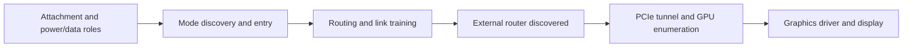

# How the connection works

The USB-C connector carries several kinds of traffic. DEG2's USB hub can work even when the USB4 connection needed by the GPU has failed.

## From plugging in to a working GPU

This is a dependency diagram, not a recovered ASUS timing sequence. Some operations overlap or occur inside firmware. In the ASUS captures, attachment and ordinary USB enumeration succeed, but external-router discovery is absent at the recorded checks. The unresolved part is mode entry, link establishment, or an early loss of that link.

## Which component does what?

| Component | Role | What we know on this laptop |
| --- | --- | --- |
| ITE IT8857FN | USB-C/Power Delivery controller family; participates in role and mode negotiation | Physical marking photographed. Its exact installed program and failed-entry decision remain unknown |
| ASUS embedded-controller firmware | Relays the inspected UCSI requests | The original relay code was recovered. A fixed `IT8853` diagnostic string had been mistaken for the physical chip identity |
| UCSI | OS interface for Type-C status and control | We have commands, replies and software state; these are not the raw PD messages on the cable |
| Parade PS8830 A3 | Retimes and switches the high-speed signal path | Physical marking photographed; attachment-time configuration and training outcome were not captured |
| RT0 / NHI0 | USB4 host-router instance associated with the tested connector | Confirmed for the failed connection; RT1 is a separate instance |
| DEG2 router | External router through which the GPU's PCIe traffic must pass | Appears on Dell; absent at recorded ASUS checks |
| RTX 4080 SUPER | PCIe endpoint and display source | Works in the Dell control; cannot enumerate through a missing USB4 connection |

[Chip photographs](board-photo-review.md) · [EC relay](ec-firmware-decision.md) · [Component references](component-behavior.md).

Parade's [PS8830 diagram](https://www.paradetech.com/products/ps8830/) shows separate signal and control paths. It helps explain the architecture but is not the FA507XI wiring schematic. Microsoft's [connection-manager description](https://learn.microsoft.com/en-us/windows-hardware/design/component-guidelines/usb4-intro-to-connection-manager) separates router detection, tunnel configuration and host-to-host support. Success in one does not establish all three.

## Configuration is different from a result

A controller can request USB4 mode without the link training successfully. Reading a software-written retimer mode bit would tell us the requested configuration; we would still need a separate result. Likewise, a final missing router cannot distinguish a link that never formed from one that formed briefly and disappeared.

The other photographed parts have different jobs. PS8802 is a 10 Gbps USB-C/DisplayPort device; PS8419 serves HDMI. Neither is a substitute source for the missing USB4 link state. [Register meanings and read behaviour](component-behavior.md).

## Names used in the records

- **Connector 1 → XHC3 → NHI0/RT0:** the mapped failing ASUS path. A dock's downstream hub-port number is not an ASUS connector number. [Mapping](rt0-attachment-order.md).
- **RouterDetected:** a host-register field sampled during router detection. One sample does not describe every earlier state.
- **Billboard:** a USB interface reporting supported modes and their status. The cached report is useful, but does not identify a failed PD packet.
- **Auto:** firmware chooses a setting. Reading the stored value does not reveal the choice it ultimately made.
- **PCIe authorization:** permission for PCIe access. A router may be visible while its downstream PCIe devices remain unavailable.

[Findings](status.md) · [Diagnosis plan](investigation-plan.md) · [Documentation index](README.md)
