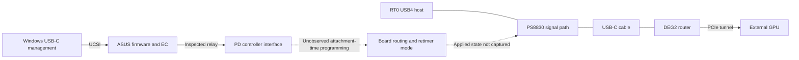

# How the connection works

Several different systems share the USB-C connector. Ordinary USB working does not establish that the USB4 transport and PCIe tunnel are working.

## The components

| Component | Job in this investigation |
| --- | --- |
| USB-C / Power Delivery controller | Detects attachment, negotiates power/data roles and participates in mode entry. The original firmware names an IT8853 interface; that literal is not an independent chip-marking read |
| ASUS embedded controller (EC) | Relays the inspected UCSI requests between Windows and the controller-facing transport |
| UCSI | The standard status/control interface Windows uses. Its messages are not a raw PD-wire recording |
| PS8830 retimer | Handles the high-speed signal path. The ASUS package/code identifies this family; the actual failed-attachment programming sequence remains missing |
| RT0 / NHI0 | The native USB4 host-router instance associated with the tested ASUS connector |
| DEG2 router | The external device Windows must discover before creating the GPU's PCIe tunnel |
| RTX 4080 SUPER | The PCIe endpoint, followed by the graphics driver and display output |

## Two paths to keep separate

The solid relay is supported by the original code. The dotted programming relationships identify missing observations; they are not recovered ASUS commands or a verified wiring schematic. [Code evidence](../evidence/ec-firmware-decision.json), [PS8830 investigation](../evidence/ps8830-configuration-path.json).

## What normally needs to happen

1. Detect attachment and establish suitable power/data roles.
2. Discover the partner/cable and select USB4 or a compatible mode.
3. Apply the necessary routing and retimer configuration and establish the link.
4. Discover the external router.
5. Create an authorized PCIe tunnel, enumerate the GPU, then load its graphics driver.

Some steps overlap or run inside firmware. This sequence explains the dependencies; it is not a timestamped reconstruction of the failed handshake.

The ASUS evidence establishes attachment, UCSI activity and ordinary USB host enumeration. It does not expose enough of steps 2–3 to identify the first failed physical transition. Step 4 remains absent at the recorded checks. [Current findings](status.md).

## Port names

Connector 1 maps through XHC3 to NHI0/RT0 in the retained ASUS data. RT1/NHI1 is a separate host-router instance. A dock's hub port 4 is a downstream hub-port number, not ASUS connector 4. Linux names its own ports, so the collector records firmware paths rather than assuming Linux port 0 equals Windows connector 1. [Mapping](rt0-attachment-order.md).

## A few terms used in the detailed notes

- **RouterDetected:** a host register field used during external-router detection. A sampled value is not a history of every earlier link state.
- **Billboard:** a USB interface that reports mode-support/status information. Its presence does not identify a failed PD packet or prove how the retimer was programmed.
- **Auto:** firmware chooses a setting. A stored Auto value does not reveal that resolved choice.
- **Authorization:** permission to create PCIe access after router detection. Linux can expose the router while leaving the GPU unavailable pending authorization.

[Documentation index](README.md) · [Technical architecture and evidence map](investigation-map.md)
