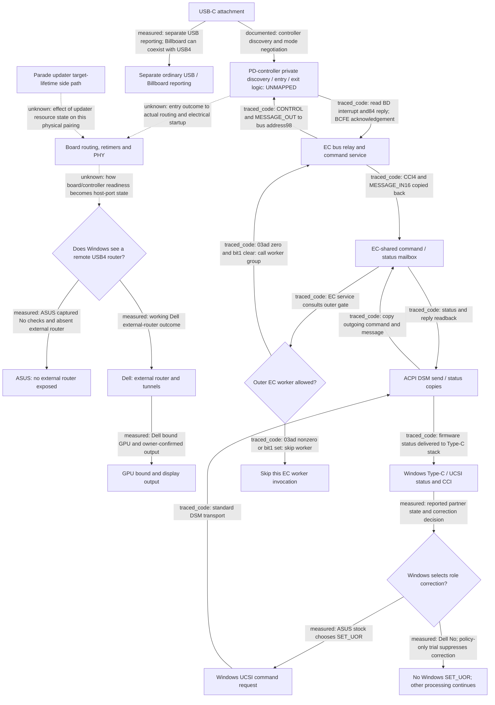

# USB4 investigation: current evidence map

Generated from `evidence/investigation-model.json` by `tools/analysis/Read-Investigation.py`. This report checks source pins and relationships; interpretations remain analyst judgments.

**Current goal:** Locate the first failed branch in the ASUS-DEG2 control/message flow, identify its owning component and an observable that distinguishes it, then select one reversible intervention with a predicted outcome.

**Working repair:** With the existing dock, GPU and cable, restore ASUS router/GPU enumeration and display output using a reversible Windows remedy, then verify reconnect and removal/rollback. No working remedy is established.

Observed boundary: ASUS reports attachment and PD/control activity, yet Windows does not enumerate the external router. The unobserved interval includes USB4 entry, board signal routing, electrical link establishment and the transition to router discovery. A missing router alone cannot separate those steps.

[Working method and experiment rules](investigation-plan.md).

## Architecture and control-flow branches

This is the bounded architecture/control-flow map, not a complete recovered PD firmware state machine. Branches tagged traced_code come from the reviewed BIOS image, whose live-flash match remains unverified. Measured edges describe software reports/outcomes. The private controller decision and board-to-host readiness path remain explicitly unmapped. Windows UCSI command completion and Windows USB4 router discovery are separate observation paths.

Solid arrows identify documented, traced-code or measured relationships. Dashed arrows mark an unobserved or untraced relationship. Edge labels preserve that distinction.

### Who owns each part

| Node | Owner / responsibility | Input and output | Known limit |
| --- | --- | --- | --- |
| ATTACH | Laptop, cable and dock connection | Physical connection and control signaling | No raw physical insertion/CC packet timestamp. |
| PD | Expected IT8853-family controller; executing image not independently identified | Partner/cable discovery and mode-control exchange; EC bus access | Entry policy, actual request/reply history and exact running firmware unknown. |
| LINK | ASUS board signal path plus host/dock PHYs | Mode/routing decisions and electrical link establishment | Port-specific programming ownership and failing live state unresolved. |
| PORT | Windows USB4 host/root-router stack | Host-port state checks and router/configuration discovery | No result alone does not reveal whether entry, training or configuration failed. |
| ABSENT | Observed failed enumeration endpoint | No dock router, tunnels or external GPU in recorded state | This is the failure boundary we can currently observe. |
| ROUTER | Windows USB4 connection manager | Router configuration and tunnel setup | A successful Dell platform does not identify the ASUS failing instruction. |
| GPU | PCIe enumeration and GPU/display stack | Tunneled PCIe endpoint, NVIDIA driver and output | Output confirmation in the earlier Dell control followed trace recording. |
| USB | Dock USB interface and Windows USB stack | USB descriptors and cached mode outcome | Billboard also exists on the working Dell; presence alone is not failure. |
| STATUS | UcmUcsiCx / UcmCx and firmware reports | Reported roles, power contract, command completion | These reports are not raw PD packets or a certified USB4 link. |
| ROLE | Windows policy and reported partner state | Decision to issue SET_UOR | Full condition is not represented as a simple policy-byte equality. |
| UCSI | Windows UCSI stack | CONTROL and optional MESSAGE_OUT; SET_UOR or mode-exit example | A supported command transport does not expose arbitrary private PD policy. |
| AML | ASUS CPMUCSI AML | Copies command/message data and reply/status via EC mailbox | This transport is not the private PD discovery/entry state machine. |
| MAILBOX | Host-visible firmware transport and EC service | Outgoing CONTROL/MESSAGE_OUT; incoming CCI/MESSAGE_IN | Reading its backing memory live remains an access issue; not a wire history. |
| GATE | ASUS EC bank1b23c | 03ad and030e.bit1 gate call to bank3bc20 group | Live flag value unmeasured; further internal readiness/IRQ gates also exist. |
| RELAY | EC bank3bc20/c89a and bacf/bba3/bb4f | Channel4, address byte98; normal transfer/reply/acknowledgement | A relay does not reveal how the PD controller chooses native USB4 entry. |
| CFU | Existing retimer update-driver software | Retained target handles after failed version read | Its physical effect on DEG2 negotiation is unproved; peer control weakens a universal blocker. |
| NO_ROLE_CMD | Windows role-correction decision | No role command issued for this decision | Dell success and ASUS policy-trial failure are separate outcomes; no command is not a connection failure. |
| EC_SKIPPED | EC outer service gate | Return before bank3bc20 group | This is one invocation; continued suppression depends on gate state. It is not the Windows no-role-command branch. |

### Branch evidence

| From → to | Branch / message | Basis | Evidence |
| --- | --- | --- | --- |
| ATTACH → PD | controller discovery and mode negotiation | documented | MS-DESIGN |
| PD → LINK | entry outcome to actual routing and electrical startup | unknown | C12, C19 |
| LINK → PORT | how board/controller readiness becomes host-port state | unknown | C04, C12, C19 |
| PORT → ABSENT | ASUS captured No checks and absent external router | measured | C04 |
| PORT → ROUTER | working Dell external-router outcome | measured | C01 |
| ROUTER → GPU | Dell bound GPU and owner-confirmed output | measured | C01 |
| ATTACH → USB | separate USB reporting; Billboard can coexist with USB4 | measured | C11, C14 |
| STATUS → ROLE | reported partner state and correction decision | measured | C03 |
| ROLE → UCSI | ASUS stock chooses SET_UOR | measured | C03, C05 |
| ROLE → NO_ROLE_CMD | Dell No; policy-only trial suppresses correction | measured | C03, C05 |
| UCSI → AML | standard DSM transport | traced_code | C22 |
| AML → MAILBOX | copy outgoing command and message | traced_code | C22 |
| MAILBOX → GATE | EC service consults outer gate | traced_code | C08 |
| GATE → RELAY | 03ad zero and bit1 clear: call worker group | traced_code | C08, C20 |
| GATE → EC_SKIPPED | 03ad nonzero or bit1 set: skip worker | traced_code | C08 |
| RELAY → PD | CONTROL and MESSAGE_OUT to bus address98 | traced_code | C20 |
| PD → RELAY | read BD interrupt and84 reply; BCFE acknowledgement | traced_code | C20 |
| RELAY → MAILBOX | CCI4 and MESSAGE_IN16 copied back | traced_code | C20 |
| MAILBOX → AML | status and reply readback | traced_code | C22 |
| AML → STATUS | firmware status delivered to Type-C stack | traced_code | C06, C22 |
| CFU → LINK | effect of updater resource state on this physical pairing | unknown | C02, C13 |

### Candidate intervention locations

| Location | What a change would affect | Evidence / current decision |
| --- | --- | --- |
| ROLE | Pre-attachment Windows role policy; suppresses SET_UOR. | Already tested; insufficient by itself. Reopen only with new causal evidence. (C05) |
| UCSI | A standard mode-exit request through the existing stack. | One request rejected; no unchanged retry or guessed mode number. (C21) |
| GATE | Vendor host command76 clears the outer service-blocking bit. | Unmeasured live state and no link to private entry policy; no selected write test or dedicated driver. (C08, C09, C10) |
| PD | Private controller entry/cable-policy change. | Target firmware, command semantics and recovery unidentified; no qualified intervention. (C12, C19) |
| LINK | Actual routing, retimer or PHY setting. | Needs port ownership and observed failing state; no arbitrary mux/reset/flash. (C02, C13, C19) |
| PORT | Windows router-discovery/configuration behavior. | A usable-link/failed-discovery observation would make this branch a targeted investigation; none yet. (C04, C19) |

## Connection stages

These stages can overlap. Windows report order is not a recovered sequence of wire messages.

| Stage | ASUS failed pairing | Dell working control | Still missing |
| --- | --- | --- | --- |
| 1. USB-C attachment and reported power/data roles | Attachment and PD reported; later Windows role correction. | Attachment reported; partner UFP by first PD report in control. | Raw CC/PD capability exchange, precise physical insertion time. |
| 2. Windows-UCSI / ACPI / EC supervision | Normal commands complete; policy-only trial ineffective. | Working control without recorded SET_UOR; platform policy differs. | Meaning of private firmware state in the failing physical interval. |
| 3. Controller USB4 discovery and entry/exit decision | Cached status NotAttemptedOrExited. | Cached status Successful. | Fresh discovery, entry request/reply and exit history; actual PD firmware identity. |
| 4. Board signal path and electrical link establishment | DEG2 path unmeasured; peer link works in a separate control. | Usable link inferred from operational router/tunnels. | Per-port routing, retimer and PHY state during this failed pairing. |
| 5. Windows USB4 router discovery and tunnels | External router absent at captured checks. | External router and working tunnels present. | Whether a usable physical link ever existed before failed/absent discovery. |
| 6. GPU/output and ordinary USB fallback | No external GPU/output; USB fallback enumerates. | NVIDIA GPU bound; owner confirmed output. | A reproducible repair, followed by reconnect and recovery validation. |

## What backs the map

Measured = retained real observation; code_fact = implementation in a pinned image; inference = interpretation with a stated reason; unknown = identified missing observation.

**C01 — measured:** DEG2 enumerated a USB4 router and NVIDIA GPU on Dell; the owner confirmed display output.

Scope: DELL-CONTROL. The display confirmation followed recording. This establishes that pairing; it does not certify ASUS signal margin or identical platform policy.

[DELL-WORKING](../evidence/observations.json) `/dell_deg2_control`

**C02 — measured:** ASUS formed a reported40Gbps peer link in a boot bookended by dumps containing retained updater targets.

Scope: ASUS-PEER. Target state was not sampled inside the peer trace. A peer link does not test DEG2 compatibility or PCIe tunnelling.

[PEER-CONTROL](../evidence/i2c-read-prerequisites.json) `/same_boot_correlation`

**C03 — measured:** ASUS and Dell initially reported partner DFP. Dell reported UFP by its first PD report; ASUS corrected the role later.

Scope: ASUS-DEEP, DELL-CONTROL. Different runs/platforms and power contracts. These are asynchronous Windows reports, not cable packets or proof that the role difference causes failure.

[ASUS-TIMELINE](../evidence/asus-dell-matched-comparison.json) `/trace/milestones`, [DELL-TIMELINE](../evidence/negotiation-followup.json) `/Comparisons/3/Events`

**C04 — measured:** ASUS reported successful role correction while the external USB4 router remained absent at the recorded checks.

Scope: ASUS-DEEP, DELL-DEEP. An early No result is not a terminal failure event. Missing enumeration does not identify whether entry or electrical training failed.

[ASUS-TIMELINE](../evidence/asus-dell-matched-comparison.json) `/trace/milestones`, [ASUS-COMPARE](../evidence/asus-dell-matched-comparison.json) `/comparison`

**C05 — measured:** A controlled policy1 intervention suppressed the recorded Windows SET_UOR correction but did not make DEG2 enumerate; stock policy was subsequently verified restored.

Scope: ASUS-POLICY-OVERRIDE, ASUS-POLICY-STOCK. One controlled pair. This rejects that tested intervention as sufficient, not every Windows remedy or every role-related firmware interaction.

[POLICY-PAIR](../evidence/role-policy-experiment.json) `/actual_attachment_result`, [POLICY-ROLLBACK](../evidence/role-policy-experiment.json) `/rollback_verification`

**C06 — measured:** The failed normal ASUS trace has10 Windows UCSI commands and10 terminal completions with no recorded CCI error/busy/unsupported.

Scope: ASUS-DEEP. Command completion establishes the captured control exchanges, not USB4 entry, wire Accept, routing or link training.

[ASUS-COMMANDS](../evidence/asus-dell-matched-comparison.json) `/trace/windows_commands`, [ASUS-COMPLETIONS](../evidence/asus-dell-matched-comparison.json) `/trace/terminal_command_completions`, [ASUS-ERRORS](../evidence/asus-dell-matched-comparison.json) `/trace/cci_error_busy_unsupported`

**C07 — code_fact:** In BIOS314 the OEM table6 getter returns without producing a reply; its IT8853 identity getter returns literal constants.

Scope: ASUS-BIOS314. This explains the diagnostic response timeout in that build. Live EC flash was not hash-matched; the literal identity is not an independent chip identification.

[EC-GETTERS](../evidence/ec-firmware-decision.json) `/oem_interface`, [EC-LIVE-MATCH](../evidence/ec-firmware-decision.json) `/source/live_flash_hash_verified`

**C08 — code_fact:** The EC flag gates the outer UCSI worker; vendor host command75 sets it and76 clears it, with other writer paths also identified.

Scope: ASUS-BIOS314. No attachment-triggered setter or autonomous USB4-entry decision has been established. Commands75/76 are not UCSI opcodes.

[FLAG-GATE](../evidence/ec-blocking-flag.json) `/outer_gate`, [FLAG-WRITERS](../evidence/ec-blocking-flag.json) `/writers`, [EC-LIVE-MATCH](../evidence/ec-firmware-decision.json) `/source/live_flash_hash_verified`

**C09 — unknown:** The flag value during the failed physical attachment remains unknown; the attempted application access paths returned no value.

Scope: ASUS-FLAG-RESEARCH. A candidate address is not a working reader. No live flag clear or physical-memory read was performed.

[FLAG-UNMEASURED](../evidence/ec-blocking-flag.json) `/flag`, [FLAG-ACCESS](../evidence/ec-blocking-flag.json) `/live_access_checks`

**C10 — inference:** A continuously blocked UCSI worker is less consistent with the captured successful commands; a short pulse is still possible.

Scope: ASUS-BIOS314, ASUS-DEEP. Crosses code and capture evidence. It assumes the reviewed EC implementation applies; it does not establish actual bit values.

Reason: The original outer gate skips the worker that services those commands. Repeated completions oppose that gate staying set throughout the exchanges.

[FLAG-GATE](../evidence/ec-blocking-flag.json) `/outer_gate`, [EC-LIVE-MATCH](../evidence/ec-firmware-decision.json) `/source/live_flash_hash_verified`, [ASUS-COMMANDS](../evidence/asus-dell-matched-comparison.json) `/trace/windows_commands`, [ASUS-COMPLETIONS](../evidence/asus-dell-matched-comparison.json) `/trace/terminal_command_completions`

**C11 — measured:** The cached DEG2 USB4 status is Successful on Dell and NotAttemptedOrExited on ASUS.

Scope: ASUS-DEEP, DELL-DEEP. A cached device report cannot distinguish skipped entry from later exit, or prove freshness, packet order or link-training outcome.

[BOS-ASUS](../evidence/billboard-comparison.json) `/hosts/asus/billboard/modes/0`, [BOS-DELL](../evidence/billboard-comparison.json) `/hosts/dell/billboard/modes/0`

**C12 — unknown:** The actual cable discovery, Enter_USB/response history and subsequent entry/exit order have not been recovered.

Scope: ASUS-DEEP, DELL-DEEP. Additional analysis of existing summaries cannot reconstruct an event never retained.

[BOS-LIMITS](../evidence/billboard-comparison.json) `/comparison`

**C13 — inference:** The updater target-lifetime defect is not established as the sole USB4 blocker.

Scope: ASUS-PEER. Specific effects on DEG2 remain possible. The peer control is counterevidence to a universal blocker, not proof the defect is harmless.

Reason: Working peer traffic occurred between same-boot dumps with the retained target identities present.

[PEER-CONTROL](../evidence/i2c-read-prerequisites.json) `/same_boot_correlation`, [PEER-INTERPRETATION](../evidence/i2c-read-prerequisites.json) `/conclusion`

**C14 — measured:** The xHCI Device Qualifier descriptor stall occurred after the first no-router observation; reset succeeded and enumeration continued.

Scope: ASUS-DEEP. This identifies a later USB fallback event. It does not explain the earlier absence or identify a PD-wire error.

[LATE-STALL](../evidence/trace-gaps-and-ec-bus.json) `/stall`

**C15 — measured:** ASUS and Dell selected different reported PD contracts from the same advertised source profiles.

Scope: ASUS-DEEP, DELL-DEEP. RDO values describe requested contracts, not measured power. Their causal effect is untested; forced power changes are not justified.

[POWER-ASUS](../evidence/billboard-comparison.json) `/hosts/asus/reported_contract`, [POWER-DELL](../evidence/billboard-comparison.json) `/hosts/dell/reported_contract`, [BOS-LIMITS](../evidence/billboard-comparison.json) `/comparison`

**C16 — measured:** The Rp-only trial established no recorded attachment; the preconnected-startup trial still lacked a router/GPU.

Scope: ASUS-COLD, ASUS-RP-ONLY. These are separate cases. Rp-only did not establish its intended changed condition; cold-start collection began after sign-in and missed initial negotiation.

[RP-RESULT](../evidence/initial-role-result.json) `/Result`, [COLD-RESULT](../evidence/cold-start-result.json) `/snapshots`, [COLD-COVERAGE](../evidence/cold-start-result.json) `/coverage`

**C17 — inference:** Matching14 copied Windows images narrows binary differences but does not establish identical runtime policy or exclude Windows involvement.

Scope: ASUS-DEEP, DELL-DEEP. Copied-image equality is not equality of every loaded stack, setting, firmware service or operating condition.

Reason: The same comparison also records unequal platform policy and ACPI support masks.

[ASUS-COMPARE](../evidence/asus-dell-matched-comparison.json) `/comparison`

**C18 — inference:** The live IT8853 string and the connected OEM PDO timeout cannot be promoted into independent physical-chip identification or a clean port-mapping comparison.

Scope: ASUS-BIOS314, ASUS-OEM. Preserve the actual successful string read and failed request. The owner reported UGREEN insert/remove before DEG2 in that connected run.

Reason: Original EC instructions construct the string; the connected-run record explicitly marks the before/after comparison unclean.

[OEM-IDENTITY](../evidence/oem-pd-diagnostics.json) `/live_runs/1`, [OEM-CONFOUNDED](../evidence/oem-pd-diagnostics.json) `/live_runs/3`, [EC-GETTERS](../evidence/ec-firmware-decision.json) `/oem_interface`

**C19 — unknown:** No identified available Windows interface currently supplies the missing entry/exit history or validated routing-state observation.

Scope: ASUS-FLAG-RESEARCH, ASUS-INTERFACES. Existing interfaces and helpers have been identified, but their applicability/readability/side effects are not interchangeable. This is an access gap, not proof software repair is impossible.

[ACCESS-INTERFACES](../evidence/control-reachability.json) `/findings`, [FLAG-ACCESS](../evidence/ec-blocking-flag.json) `/live_access_checks`

**C20 — code_fact:** The original EC relay copies CONTROL and MESSAGE_OUT to controller-bus channel4/address byte98 and reads CCI/MESSAGE_IN back with acknowledgement.

Scope: ASUS-BIOS314. This establishes a transport path in the reviewed image. Bus success, PD acceptance and private USB4-entry policy are not supplied by this code alone.

[EC-RELAY](../evidence/ec-firmware-decision.json) `/ucsi_relay`, [EC-LIVE-MATCH](../evidence/ec-firmware-decision.json) `/source/live_flash_hash_verified`

**C21 — measured:** The single guarded SET_NEW_CAM EXIT request received a terminal firmware rejection; no successful exit or recovered router/GPU was established.

Scope: ASUS-MODE-EXIT. The error branch had no20-second passive window; immediate device state does not reveal internal mode retention. Do not repeat unchanged.

[MODE-EXIT](../evidence/observations.json) `/asus_current_mode_exit_experiment`

**C22 — code_fact:** Recovered CPMUCSI AML exposes standard DSM command/status copies to and from the EC mailbox; it supplies no separate identified USB4-entry method.

Scope: ASUS-INTERFACES. An ACPI transport method is not the full controller policy state machine. Finding a method does not qualify an application interface to invoke it.

[AML-TRANSPORT](../evidence/control-reachability.json) `/findings/ucsi`

## Separate runs and observation limits

| Case | Meaning | Important limit |
| --- | --- | --- |
| ASUS-DEEP | Normal failed attachment; trace2026-11-01 00:52; dump00:53 | No physical PD packets or complete controller-private memory; dump follows trace. |
| DELL-DEEP | Working Dell deep capture; dump2026-11-01 00:20 | Used for cached state/platform comparison, not substituted into the21:25 timeline. |
| DELL-CONTROL | Working Dell pre-attachment control2026-10-31 21:25 | Separate earlier run; native diagnostic GETs followed GPU binding; display confirmation followed recording. |
| ASUS-PEER | ASUS-Dell peer link2026-10-31 13:37 | Different partner; reported link rate, not DEG2 PCIe throughput; retained targets bookend the trace. |
| ASUS-POLICY-STOCK | Powered stock-driver baseline2026-11-01 12:xx | Separate experimental-session baseline, not the00:52 trace. |
| ASUS-POLICY-OVERRIDE | One policy1 filter attachment2026-11-01 12:xx | Changed Windows role-correction behavior without USB4 recovery; rollback verified. |
| ASUS-COLD | Preconnected startup observed after sign-in | Initial BIOS/PD/link sequence not recorded. |
| ASUS-RP-ONLY | Initial-role experiment | No recorded attachment; the intended changed condition was not established. |
| ASUS-OEM | OEM capability/identity/PDO reads2026-11-01 16:xx | Literal identity; connected PDO run confounded by UGREEN insertion/removal. |
| ASUS-FLAG-RESEARCH | Static read target and application access checks | No live flag value or failed-attachment flag timeline. |
| ASUS-INTERFACES | Recovered AML/interface/driver inspection | Method existence and similar endpoint layout do not qualify live access/protocol. |
| ASUS-BIOS314 | Pinned ASUS BIOS314 EC image and offline execution | Running EC flash not hash-matched; peripherals are modeled, not hardware-tested. |
| ASUS-MODE-EXIT | One guarded mode-exit request2026-10-31 22:12 | Terminal firmware rejection; immediate snapshot only. No successful exit or USB4 recovery. |

## Software-report timelines

T0 is the first recorded Windows attachment report in each run, not physical insertion. Different runs, platforms, power contracts and capture dates are explicit. These tables align software reports only; proximity does not establish wire order or causation. The earlier Dell control supplies the Dell timeline; the deep Dell dump supplies cached-state comparison.

### ASUS-DEEP

Source: [ASUS-TIMELINE](../evidence/asus-dell-matched-comparison.json) `/trace/milestones`

| Recorded UTC | Seconds from first recorded attachment report | Report |
| --- | ---: | --- |
| 2026-11-01T00:52:16.9317051Z | 0.0000000 | Initial partner DFP / USB flag 1 |
| 2026-11-01T00:52:17.0075650Z | 0.0758599 | First PD report remains partner DFP / USB flag 1 |
| 2026-11-01T00:52:17.0829942Z | 0.1512891 | USB4 port 2 plugged check No, before correction |
| 2026-11-01T00:52:17.0830516Z | 0.1513465 | USB4 port 2 router-detected check No, before correction |
| 2026-11-01T00:52:17.0965056Z | 0.1648005 | PD negotiation reported successful |
| 2026-11-01T00:52:17.1299775Z | 0.1982724 | Windows role-correction decision Yes |
| 2026-11-01T00:52:17.1464315Z | 0.2147264 | Windows SET_UOR DFP requested |
| 2026-11-01T00:52:17.1631249Z | 0.2314198 | SET_UOR command completed without CCI error |
| 2026-11-01T00:52:17.1631368Z | 0.2314317 | Windows reports local DFP role success |
| 2026-11-01T00:52:17.2060961Z | 0.2743910 | Firmware later reports partner UFP / USB flag 1 |
| 2026-11-01T00:52:27.8953049Z | 10.9635998 | Second USB4 port 2 plugged check No, after correction |
| 2026-11-01T00:52:27.8953782Z | 10.9636731 | Second USB4 port 2 router-detected check No, after correction |

### DELL-CONTROL

Source: [DELL-TIMELINE](../evidence/negotiation-followup.json) `/Comparisons/3/Events`

| Recorded UTC | Seconds from first recorded attachment report | Report |
| --- | ---: | --- |
| 21:25:17.386 | 0.0000000 | Connected:1 UcsiPowerDirectionConsumer UcsiBatteryChargingNominal UcsiPowerOperationModeTypeC3000 RDO:0x0 |
| 21:25:17.386 | 0.0000000 | UcsiConnectorPartnerTypeDfp PartnerFlags:0x1[USB   ] |
| 21:25:17.790 | 0.4040000 | Connected:1 UcsiPowerDirectionConsumer UcsiBatteryChargingNominal UcsiPowerOperationModePd RDO:0x438781e0 |
| 21:25:17.790 | 0.4040000 | UcsiConnectorPartnerTypeUfp PartnerFlags:0x1[USB   ] |
| 21:25:18.110 | 0.7240000 | Role-correction decision: No |
| 21:25:18.209 | 0.8230000 | UcsiConnectorPartnerTypeUfp PartnerFlags:0x1[USB   ] |
| 21:25:22.351 | 4.9650000 | UcsiConnectorPartnerTypeUfp PartnerFlags:0x1[USB   ] |

## Explanations still requiring a distinguishing observation

These explanations can occur together; this is not a probability ranking or an exhaustive fault list.

**H-ENTRY — open:** USB4 entry is skipped or refused during discovery/policy negotiation.

Evidence to consider: C11. Counterevidence: None directly discriminating.

Needed: A fresh entry request/response or an understood controller decision record.

**H-LINK — open:** Entry is attempted but routing, retimer/PHY or partner compatibility prevents a usable link.

Evidence to consider: C04. Counterevidence: C01, C02.

Needed: Entry outcome plus per-port link/routing result; successful controls limit universal faults but do not exclude pairing-specific failure.

**H-EXIT — open:** USB4 entry/link starts briefly and then exits or recovers into fallback.

Evidence to consider: C11. Counterevidence: None directly discriminating.

Needed: Timestamped positive entry/link observation followed by exit/loss. Cached NotAttemptedOrExited cannot distinguish it.

**H-ENUM — open:** A usable link exists at some point, but router configuration/discovery fails before Windows exposes the external router.

Evidence to consider: C04. Counterevidence: None directly discriminating.

Needed: Link-ready evidence plus router/configuration transaction outcomes. No-router observations alone do not rule this out.

**H-ROLE-ONLY — tested intervention insufficient:** Suppressing Windows role correction alone restores USB4.

Evidence to consider: C03, C17. Counterevidence: C05.

Needed: New causal evidence beyond the already completed policy-only trial before reopening.

**H-GATE — secondary lead; no live value:** The EC blocking bit stays set and stops host command service during failure.

Evidence to consider: C08. Counterevidence: C06, C10.

Needed: A valid live observation correlated with the failed interval; one bit would still not distinguish all four main explanations.

**H-UPDATER — defect preserved; sole-cause claim weakened:** Retained updater targets universally prevent ASUS USB4.

Evidence to consider: No direct observation. Counterevidence: C02, C13.

Needed: Pairing-specific causal evidence before any cleanup patch is presented as a DEG2 repair.

## Next actions ranked by useful information and disruption

| Action | Decision | Information gained | Owner disruption |
| --- | --- | --- | --- |
| Consolidate existing sources, cases and timelines | completed in this phase | A checked map of evidence, ambiguities and prior exclusions; no new handshake data claimed. | Zero installs, boots or reconnections. |
| Qualify an observation of the missing transition | next offline work | Find whether existing retained logs or an understood software interface can distinguish entry, link, exit or router-discovery failure. | Existing files and primary documentation first; no live requests authorized by this action. |
| Build a dedicated flag-reader driver | deferred; no longer default next step | Answers a narrow host-service gate question; cannot reconstruct entry/exit or signal routing. | New kernel code, signing/loading and recovery burden; requires stronger benefit than present counterevidence. |
| One shared read-only observer, if essential | conditional; not ready for hardware | Several port-owned, understood fields in one capture; only after the returned values separate named explanations. | At most one proposed temporary helper; a loading/recovery plan and a useful positive control are prerequisites, not yet satisfied. |
| Repeat a generic full dump or unchanged collector | not selected | Does not supply already-missing controller-private history without a new capture capability. | Owner time, reconnection and possible system load. |
| Repeat policy, mode-exit, table6 or cold-start tests | not selected without a new discriminating condition | Existing results already bound those exact attempts; more repetitions do not identify the missing transition. | Avoidable reconnections, boot or command side effects. |
| Prepare a precise OEM logging/firmware question if software visibility ends | contingency; no contact sent | Ask for the responsible PD firmware/decision log and validated read-only diagnostics, backed by the mapped failing/working evidence. | No machine change; depends on external documentation or engineering response. |

**New live experiments queued: zero. New observer drivers approved by this plan: zero.**

## Corrections and historical traps

- The earlier ASUS summary says342 unknown records; the later analysis decoded those same342. That earlier decode-count field is superseded, not a reason to repeat decoding or claim Dell unknown records are also resolved. Sources: [OLD-GAPS](../evidence/asus-dell-matched-comparison.json) `/trace/unknown_records`, [DECODED-GAPS](../evidence/trace-gaps-and-ec-bus.json) `/trace/unknown_records_decoded`.
- The returned IT8853 string is real, but original firmware shows it is a literal build identifier. It does not independently identify physical silicon. Sources: [OEM-IDENTITY](../evidence/oem-pd-diagnostics.json) `/live_runs/1`, [EC-GETTERS](../evidence/ec-firmware-decision.json) `/oem_interface`.
- The connected OEM PDO run includes the owner-reported UGREEN insertion/removal. Preserve it as a failed read, not a clean paired port comparison. Sources: [OEM-CONFOUNDED](../evidence/oem-pd-diagnostics.json) `/live_runs/3`.
- The policy record has a historical key named current_state. It cannot establish current boot/security configuration; refresh live inventory only when a later action actually needs it. Sources: [POLICY-OLD-SNAPSHOT](../evidence/role-policy-experiment.json) `/current_state`.
- The flagged EC worker and the normal Windows command completions belong to different evidence classes. Their relation is an inference assuming the reviewed firmware applies, not a measured flag value. Sources: [FLAG-GATE](../evidence/ec-blocking-flag.json) `/outer_gate`, [EC-LIVE-MATCH](../evidence/ec-firmware-decision.json) `/source/live_flash_hash_verified`, [ASUS-COMPLETIONS](../evidence/asus-dell-matched-comparison.json) `/trace/terminal_command_completions`.

## Documentation used for architecture

- [Microsoft USB4 design requirements](https://learn.microsoft.com/en-us/windows-hardware/design/component-guidelines/usb4-design-details-and-general-requirements): The Windows USB4 connection manager has no software dependency on the Type-C stack; successful UCSI requests do not certify USB4 entry/link.
- [Microsoft USB4 connection manager](https://learn.microsoft.com/en-us/windows-hardware/design/component-guidelines/usb4-intro-to-connection-manager): Router detection/configuration, tunnel setup and domain management are distinct responsibilities.
- [Microsoft USB4 debugging and troubleshooting](https://learn.microsoft.com/en-us/windows-hardware/design/component-guidelines/usb4-debugging-and-troubleshooting): Existing trace, rundown and debugger mechanisms to audit before proposing a new observer.
