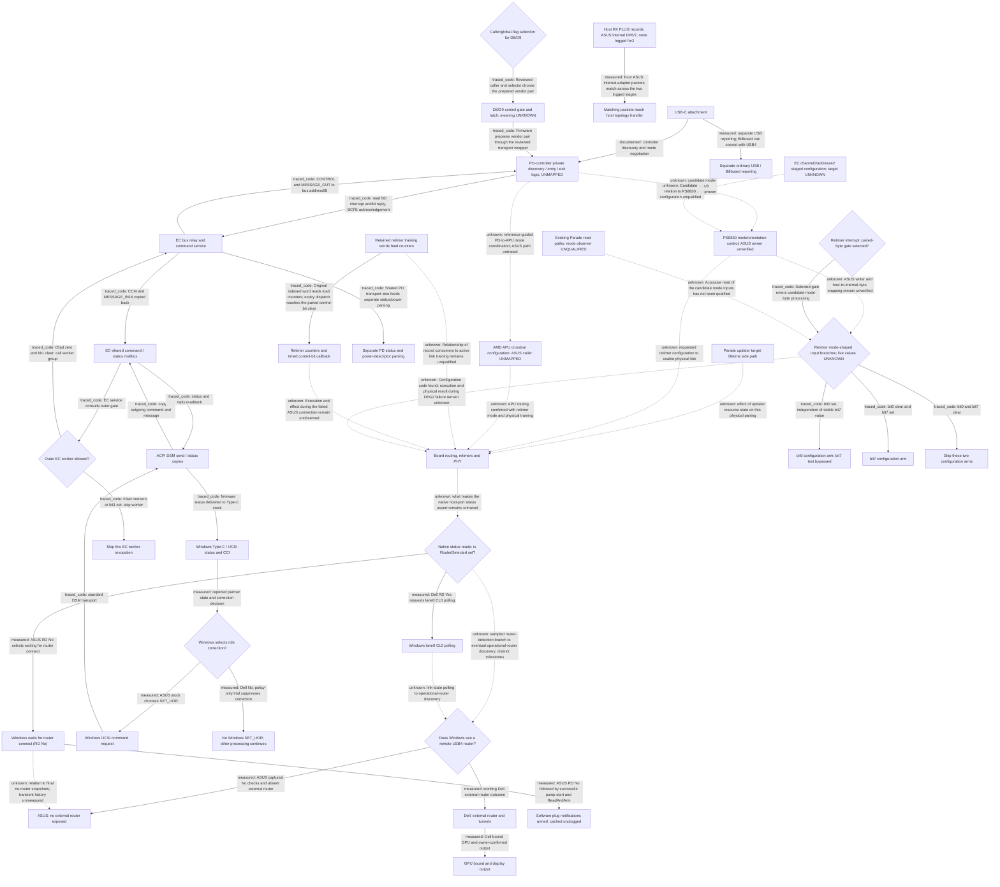

# USB4 investigation: current evidence map

Generated from `evidence/investigation-model.json` by `tools/analysis/Read-Investigation.py`. This report checks source pins and relationships; interpretations remain analyst judgments.

**Current goal:** Locate the first failed branch in the ASUS-DEG2 control/message flow, identify its owning component and an observable that distinguishes it, then select one reversible intervention with a predicted outcome.

**Working repair:** With the existing dock, GPU and cable, restore ASUS router/GPU enumeration and display output using a reversible Windows remedy, then verify reconnect and removal/rollback. No working remedy is established.

Observed boundary: ASUS reports attachment and PD/control activity, yet Windows does not enumerate the external router. The unobserved interval includes USB4 entry, board signal routing, electrical link establishment and the transition to router discovery. A missing router alone cannot separate those steps.

[Working method and experiment rules](investigation-plan.md).

## Architecture and control-flow branches

This is the bounded architecture/control-flow map, not a complete recovered PD firmware state machine. Branches tagged traced_code come from the reviewed BIOS image, whose live-flash match remains unverified. Measured edges describe software reports/outcomes. The private controller decision and board-to-host readiness path remain explicitly unmapped. Windows UCSI command completion and Windows USB4 router discovery are separate observation paths.

Solid arrows identify documented, traced-code or measured relationships. Dashed arrows mark an unobserved or untraced relationship. Edge labels preserve that distinction.

### Who owns each part

| Node | Owner / responsibility | Input and output | Known limit |
| --- | --- | --- | --- |
| ATTACH | Laptop, cable and dock connection | Physical connection and control signaling | No raw physical insertion/CC packet timestamp. |
| PD | Expected IT8853-family controller; executing image not independently identified | Partner/cable discovery and mode-control exchange; EC bus access | Entry policy, actual request/reply history and exact running firmware unknown. |
| LINK | ASUS board signal path plus host/dock PHYs | Mode/routing decisions and electrical link establishment | Port-specific programming ownership and failing live state unresolved. |
| PORT | Windows USB4 host/root-router stack | Host-port state checks and router/configuration discovery | No result alone does not reveal whether entry, training or configuration failed. |
| ABSENT | Observed failed enumeration endpoint | No dock router, tunnels or external GPU in recorded state | This is the failure boundary we can currently observe. |
| ROUTER | Windows USB4 connection manager | Router configuration and tunnel setup | A successful Dell platform does not identify the ASUS failing instruction. |
| GPU | PCIe enumeration and GPU/display stack | Tunneled PCIe endpoint, NVIDIA driver and output | Output confirmation in the earlier Dell control followed trace recording. |
| USB | Dock USB interface and Windows USB stack | USB descriptors and cached mode outcome | Billboard also exists on the working Dell; presence alone is not failure. |
| STATUS | UcmUcsiCx / UcmCx and firmware reports | Reported roles, power contract, command completion | These reports are not raw PD packets or a certified USB4 link. |
| ROLE | Windows policy and reported partner state | Decision to issue SET_UOR | Full condition is not represented as a simple policy-byte equality. |
| UCSI | Windows UCSI stack | CONTROL and optional MESSAGE_OUT; SET_UOR or mode-exit example | A supported command transport does not expose arbitrary private PD policy. |
| AML | ASUS CPMUCSI AML | Copies command/message data and reply/status via EC mailbox | This transport is not the private PD discovery/entry state machine. |
| MAILBOX | Host-visible firmware transport and EC service | Outgoing CONTROL/MESSAGE_OUT; incoming CCI/MESSAGE_IN | Reading its backing memory live remains an access issue; not a wire history. |
| GATE | ASUS EC bank1b23c | 03ad and030e.bit1 gate call to bank3bc20 group | Live flag value unmeasured; further internal readiness/IRQ gates also exist. |
| RELAY | EC bank3bc20/c89a and bacf/bba3/bb4f | Channel4, address byte98; normal transfer/reply/acknowledgement | A relay does not reveal how the PD controller chooses native USB4 entry. |
| CFU | Existing retimer update-driver software | Retained target handles after failed version read | Its physical effect on DEG2 negotiation is unproved; peer control weakens a universal blocker. |
| NO_ROLE_CMD | Windows role-correction decision | No role command issued for this decision | Dell success and ASUS policy-trial failure are separate outcomes; no command is not a connection failure. |
| EC_SKIPPED | EC outer service gate | Return before bank3bc20 group | This is one invocation; continued suppression depends on gate state. It is not the Windows no-role-command branch. |
| RET_CFG | Parade reference PD-I2C / platform-SMBus interfaces; actual ASUS writer unknown | Reference programming sets requested mode/orientation, not a verified link-ready witness | Generic manufacturer diagram and upstream driver are not ASUS board wiring; no live access qualified. |
| PORT_REGS | Windows USB4DeviceRouter native Port routines | ADP_CS_4 bit30 and USB4 port CS18 bit13; returned values available in saved traces | Current samples do not establish ever/never entry or link history; legacy TBT layout differs. |
| APU_CFG | Actual ASUS PD/EC/platform firmware ownership unknown | Reference designs coordinate PD-to-APU mode requests/results and retimer safe/target-mode programming | Reference architecture only; no recovered ASUS command sequence or live bus history. |
| CL0_POLL | Windows USB4 port state machine | Dell RD Yes requests polling; successful completion is recorded before PortConfigured | ASUS does not reach this branch in the two sampled initialization passes. Not complete physical link history. |
| WAIT_RD | Windows USB4 port state machine | ASUS sampled initialisation branches select WaitingForRouterConnect | Current No is not proof that entry or link never existed; no complete physical history. |
| NOTIFY_ARM | Windows USB4 native plug-state manager and host callback | StartNotificationPump, ReadAndArm and cached-state return | Software state is not an independent physical link or PD-wire observation. |
| RX_PLUG | Windows USB4HostRouter ring receive | Length check and route/adapter/event log | Different adapters are an internal path control, not a DEG2 link measurement. |
| TOPO_PLUG | Windows USB4HostRouter topology manager | Receipt logged before adapter lookup/client delivery | Receipt does not certify final client completion or explain missing port2 events. |
| EC42_CFG | Retained EC bank2 code | Two-byte register/data writes; desired/last-written cache and initialisation stages | No chip identity, USB4 signal ownership or live execution established. |
| PD_POWER | Retained EC bank3 readers | Private b0/b1 status and cc four-byte parser via shared read setup | Reference PDO correspondence; actual replies and physical contract unknown. |
| PD_VENDOR_CTL | EC bank3 flags and bank1/common transport wrapper | Prepared80/81 pair, success bookkeeping, separate outer service gate | No qualified USB4/mux meaning, live values or safe intervention. |
| PD_VENDOR_SELECT | EC bank1 caller, bank3 selector and setup/host-write paths | Caller gate, global selector, pair-enable gate and private latch | No measured flag state or USB4 meaning. Partial pair failure does not certify unchanged hardware. |
| RET_PARAM_TABLE | Offered PS8830 image; timer consumers traced | Indexed code-word loads, counter expiry queue and callback dispatch | Static code path, not measured active state or a Windows control interface. |
| RET_TIMER_FLOW | Retained PS8830 firmware code | Word divided by5 -> counter -> interrupt -> queue -> callback | One conditional set/clear path traced; electrical meaning, live branch and host access unknown. |
| RET_MODE_CODE | Retained PS8830 image; ASUS writer unverified | Separate bit0/bit7 configuration branches and orientation-dependent control masks | Matches reference fields by inference; host alias and failing-state values unknown. |
| RET_MODE_IRQ | Retained PS8830 image | Vector -> register save -> paired-byte bit0 predicate -> mode reads -> RETI | Hardware event names and ASUS live gate are unknown. |
| RET_MODE_B0 | Retained PS8830 code | Selected for stable masked01 or81 | Protocol interpretation is reference-based; actual ASUS input unobserved. |
| RET_MODE_B7 | Retained PS8830 code | Selected for stable masked80 | No measured execution or repair result. |
| RET_MODE_SKIP | Retained PS8830 code | Selected for stable masked00 | Earlier USB3/DP processing is separate; not a global no-mode claim. |
| RET_WINDOWS_READ | Retained PRHidDrv/PRSpbDrv packages | Cached HID feature versus CFU output and fixed-resource SPB write/read | Desired firmware-to-register alias, matching endpoint and read effects remain unknown. |

### Branch evidence

| From → to | Branch / message | Basis | Evidence |
| --- | --- | --- | --- |
| ATTACH → PD | controller discovery and mode negotiation | documented | MS-DESIGN |
| PD → RET_CFG | candidate mode-control path; ASUS ownership/wiring unproven | unknown | C12, C19, C23 |
| LINK → PORT_REGS | what makes the native host-port status assert remains untraced | unknown | C12, C19, C24 |
| PORT → ABSENT | ASUS captured No checks and absent external router | measured | C04 |
| PORT → ROUTER | working Dell external-router outcome | measured | C01 |
| ROUTER → GPU | Dell bound GPU and owner-confirmed output | measured | C01 |
| ATTACH → USB | separate USB reporting; Billboard can coexist with USB4 | measured | C11, C14 |
| STATUS → ROLE | reported partner state and correction decision | measured | C03 |
| ROLE → UCSI | ASUS stock chooses SET_UOR | measured | C03, C05 |
| ROLE → NO_ROLE_CMD | Dell No; policy-only trial suppresses correction | measured | C03, C05 |
| UCSI → AML | standard DSM transport | traced_code | C22 |
| AML → MAILBOX | copy outgoing command and message | traced_code | C22 |
| MAILBOX → GATE | EC service consults outer gate | traced_code | C08 |
| GATE → RELAY | 03ad zero and bit1 clear: call worker group | traced_code | C08, C20 |
| GATE → EC_SKIPPED | 03ad nonzero or bit1 set: skip worker | traced_code | C08 |
| RELAY → PD | CONTROL and MESSAGE_OUT to bus address98 | traced_code | C20 |
| PD → RELAY | read BD interrupt and84 reply; BCFE acknowledgement | traced_code | C20 |
| RELAY → MAILBOX | CCI4 and MESSAGE_IN16 copied back | traced_code | C20 |
| MAILBOX → AML | status and reply readback | traced_code | C22 |
| AML → STATUS | firmware status delivered to Type-C stack | traced_code | C06, C22 |
| CFU → LINK | effect of updater resource state on this physical pairing | unknown | C02, C13 |
| RET_CFG → LINK | requested retimer configuration to usable physical link | unknown | C23 |
| PORT_REGS → PORT | sampled router-detection branch to eventual operational-router discovery; distinct milestones | unknown | C24, C25, C26, C36 |
| PD → APU_CFG | reference-guided PD-to-APU mode coordination; ASUS path untraced | unknown | C30 |
| APU_CFG → LINK | APU routing combined with retimer mode and physical training | unknown | C30 |
| PORT_REGS → CL0_POLL | Dell RD Yes requests lane0 CL0 polling | measured | C34 |
| CL0_POLL → PORT | link-state polling to operational-router discovery | unknown | C34, C36 |
| PORT_REGS → WAIT_RD | ASUS RD No selects waiting for router connect | measured | C34 |
| WAIT_RD → ABSENT | relation to final no-router snapshots; transient history unmeasured | unknown | C34, C36 |
| WAIT_RD → NOTIFY_ARM | ASUS RD No followed by successful pump start and ReadAndArm | measured | C40 |
| RX_PLUG → TOPO_PLUG | Four ASUS internal-adapter packets match across the two logged stages | measured | C41 |
| EC42_CFG → RET_CFG | Candidate relation to PS8830 configuration unqualified | unknown | C45 |
| RELAY → PD_POWER | Shared PD transport also feeds separate status/power parsing | traced_code | C46 |
| PD_VENDOR_CTL → PD | Firmware prepares vendor pair through the reviewed transport wrapper | traced_code | C48 |
| PD_VENDOR_SELECT → PD_VENDOR_CTL | Reviewed caller and selector choose the prepared vendor pair | traced_code | C49, C51 |
| RET_PARAM_TABLE → LINK | Relationship of record consumers to active link training remains unqualified | unknown | C53 |
| RET_PARAM_TABLE → RET_TIMER_FLOW | Original indexed word reads load counters; expiry dispatch reaches the paired control-bit clear | traced_code | C54, C55 |
| RET_TIMER_FLOW → LINK | Execution and effect during the failed ASUS connection remain unobserved | unknown | C54, C55 |
| RET_CFG → RET_MODE_CODE | ASUS writer and host-to-internal-byte mapping remain unverified | unknown | C57, C58 |
| RET_MODE_CODE → LINK | Configuration code found; execution and physical result during DEG2 failure remain unknown | unknown | C57, C58 |
| RET_MODE_IRQ → RET_MODE_CODE | Selected gate enters candidate mode-byte processing | traced_code | C59 |
| RET_MODE_CODE → RET_MODE_B0 | bit0 set, independent of stable bit7 value | traced_code | C60 |
| RET_MODE_CODE → RET_MODE_B7 | bit0 clear and bit7 set | traced_code | C60 |
| RET_MODE_CODE → RET_MODE_SKIP | bit0 and bit7 clear | traced_code | C60 |
| RET_WINDOWS_READ → RET_MODE_CODE | A passive read of the candidate mode inputs has not been qualified | unknown | C61 |

### Candidate intervention locations

| Location | What a change would affect | Evidence / current decision |
| --- | --- | --- |
| ROLE | Pre-attachment Windows role policy; suppresses SET_UOR. | Already tested; insufficient by itself. Reopen only with new causal evidence. (C05) |
| UCSI | A standard mode-exit request through the existing stack. | One request rejected; no unchanged retry or guessed mode number. (C21) |
| GATE | Vendor host command76 clears the outer service-blocking bit. | Unmeasured live state and no link to private entry policy; no selected write test or dedicated driver. (C08, C09, C10) |
| PD | Private controller entry/cable-policy change. | Target firmware, command semantics and recovery unidentified; no qualified intervention. (C12, C19) |
| LINK | Actual routing, retimer or PHY setting. | Needs port ownership and observed failing state; no arbitrary mux/reset/flash. (C02, C13, C19) |
| PORT | Windows router-discovery/configuration behavior. | The native sampled No/Yes branch agrees with returned status. Follow why ASUS RouterDetected stays clear; forcing the software decision is not a physical-link repair. (C24, C25, C26) |

## Connection stages

These stages can overlap. Windows report order is not a recovered sequence of wire messages.

| Stage | ASUS failed pairing | Dell working control | Still missing |
| --- | --- | --- | --- |
| 1. USB-C attachment and reported power/data roles | Attachment and PD reported; later Windows role correction. | Attachment reported; partner UFP by first PD report in control. | Raw CC/PD capability exchange, precise physical insertion time. |
| 2. Windows-UCSI / ACPI / EC supervision | Normal commands complete; policy-only trial ineffective. | Working control without recorded SET_UOR; platform policy differs. | Meaning of private firmware state in the failing physical interval. |
| 3. Controller USB4 discovery and entry/exit decision | Cached status NotAttemptedOrExited. | Cached status Successful. | Fresh discovery, entry request/reply and exit history; actual PD firmware identity. |
| 4. Board signal path and electrical link establishment | DEG2 path unmeasured; peer link works in a separate control. | Usable link inferred from operational router/tunnels. | Per-port routing, retimer and PHY state during this failed pairing. |
| 5. Windows USB4 router discovery and tunnels | External router absent at captured checks. | External router and working tunnels present. | Whether a usable physical link ever existed before failed/absent discovery. |
| 6. GPU/output and ordinary USB fallback | No external GPU/output; USB fallback enumerates. | NVIDIA GPU bound; owner confirmed output. | A reproducible repair, followed by reconnect and recovery validation. |

## What backs the map

Measured = retained real observation; code_fact = implementation in a pinned image; inference = interpretation with a stated reason; unknown = identified missing observation.

**C01 — measured:** DEG2 enumerated a USB4 router and NVIDIA GPU on Dell; the owner confirmed display output.

Scope: DELL-CONTROL. The display confirmation followed recording. This establishes that pairing; it does not certify ASUS signal margin or identical platform policy.

[DELL-WORKING](../evidence/observations.json) `/dell_deg2_control`

**C02 — measured:** ASUS formed a reported40Gbps peer link in a boot bookended by dumps containing retained updater targets.

Scope: ASUS-PEER. Target state was not sampled inside the peer trace. A peer link does not test DEG2 compatibility or PCIe tunnelling.

[PEER-CONTROL](../evidence/i2c-read-prerequisites.json) `/same_boot_correlation`

**C03 — measured:** ASUS and Dell initially reported partner DFP. Dell reported UFP by its first PD report; ASUS corrected the role later.

Scope: ASUS-DEEP, DELL-CONTROL. Different runs/platforms and power contracts. These are asynchronous Windows reports, not cable packets or proof that the role difference causes failure.

[ASUS-TIMELINE](../evidence/asus-dell-matched-comparison.json) `/trace/milestones`, [DELL-TIMELINE](../evidence/negotiation-followup.json) `/Comparisons/3/Events`

**C04 — measured:** ASUS reported successful role correction while the external USB4 router remained absent at the recorded checks.

Scope: ASUS-DEEP, DELL-DEEP. An early No result is not a terminal failure event. Missing enumeration does not identify whether entry or electrical training failed.

[ASUS-TIMELINE](../evidence/asus-dell-matched-comparison.json) `/trace/milestones`, [ASUS-COMPARE](../evidence/asus-dell-matched-comparison.json) `/comparison`

**C05 — measured:** A controlled policy1 intervention suppressed the recorded Windows SET_UOR correction but did not make DEG2 enumerate; stock policy was subsequently verified restored.

Scope: ASUS-POLICY-OVERRIDE, ASUS-POLICY-STOCK. One controlled pair. This rejects that tested intervention as sufficient, not every Windows remedy or every role-related firmware interaction.

[POLICY-PAIR](../evidence/role-policy-experiment.json) `/actual_attachment_result`, [POLICY-ROLLBACK](../evidence/role-policy-experiment.json) `/rollback_verification`

**C06 — measured:** The failed normal ASUS trace has10 Windows UCSI commands and10 terminal completions with no recorded CCI error/busy/unsupported.

Scope: ASUS-DEEP. Command completion establishes the captured control exchanges, not USB4 entry, wire Accept, routing or link training.

[ASUS-COMMANDS](../evidence/asus-dell-matched-comparison.json) `/trace/windows_commands`, [ASUS-COMPLETIONS](../evidence/asus-dell-matched-comparison.json) `/trace/terminal_command_completions`, [ASUS-ERRORS](../evidence/asus-dell-matched-comparison.json) `/trace/cci_error_busy_unsupported`

**C07 — code_fact:** In BIOS314 the OEM table6 getter returns without producing a reply; its IT8853 identity getter returns literal constants.

Scope: ASUS-BIOS314. This explains the diagnostic response timeout in that build. Live EC flash was not hash-matched; the literal identity is not an independent chip identification.

[EC-GETTERS](../evidence/ec-firmware-decision.json) `/oem_interface`, [EC-LIVE-MATCH](../evidence/ec-firmware-decision.json) `/source/live_flash_hash_verified`

**C08 — code_fact:** The EC flag gates the outer UCSI worker; vendor host command75 sets it and76 clears it, with other writer paths also identified.

Scope: ASUS-BIOS314. No attachment-triggered setter or autonomous USB4-entry decision has been established. Commands75/76 are not UCSI opcodes.

[FLAG-GATE](../evidence/ec-blocking-flag.json) `/outer_gate`, [FLAG-WRITERS](../evidence/ec-blocking-flag.json) `/writers`, [EC-LIVE-MATCH](../evidence/ec-firmware-decision.json) `/source/live_flash_hash_verified`

**C09 — unknown:** The flag value during the failed physical attachment remains unknown; the attempted application access paths returned no value.

Scope: ASUS-FLAG-RESEARCH. A candidate address is not a working reader. No live flag clear or physical-memory read was performed.

[FLAG-UNMEASURED](../evidence/ec-blocking-flag.json) `/flag`, [FLAG-ACCESS](../evidence/ec-blocking-flag.json) `/live_access_checks`

**C10 — inference:** A continuously blocked UCSI worker is less consistent with the captured successful commands; a short pulse is still possible.

Scope: ASUS-BIOS314, ASUS-DEEP. Crosses code and capture evidence. It assumes the reviewed EC implementation applies; it does not establish actual bit values.

Reason: The original outer gate skips the worker that services those commands. Repeated completions oppose that gate staying set throughout the exchanges.

[FLAG-GATE](../evidence/ec-blocking-flag.json) `/outer_gate`, [EC-LIVE-MATCH](../evidence/ec-firmware-decision.json) `/source/live_flash_hash_verified`, [ASUS-COMMANDS](../evidence/asus-dell-matched-comparison.json) `/trace/windows_commands`, [ASUS-COMPLETIONS](../evidence/asus-dell-matched-comparison.json) `/trace/terminal_command_completions`

**C11 — measured:** The cached DEG2 USB4 status is Successful on Dell and NotAttemptedOrExited on ASUS.

Scope: ASUS-DEEP, DELL-DEEP. A cached device report cannot distinguish skipped entry from later exit, or prove freshness, packet order or link-training outcome.

[BOS-ASUS](../evidence/billboard-comparison.json) `/hosts/asus/billboard/modes/0`, [BOS-DELL](../evidence/billboard-comparison.json) `/hosts/dell/billboard/modes/0`

**C12 — unknown:** The actual cable discovery, Enter_USB/response history and subsequent entry/exit order have not been recovered.

Scope: ASUS-DEEP, DELL-DEEP. Additional analysis of existing summaries cannot reconstruct an event never retained.

[BOS-LIMITS](../evidence/billboard-comparison.json) `/comparison`

**C13 — inference:** The updater target-lifetime defect is not established as the sole USB4 blocker.

Scope: ASUS-PEER. Specific effects on DEG2 remain possible. The peer control is counterevidence to a universal blocker, not proof the defect is harmless.

Reason: Working peer traffic occurred between same-boot dumps with the retained target identities present.

[PEER-CONTROL](../evidence/i2c-read-prerequisites.json) `/same_boot_correlation`, [PEER-INTERPRETATION](../evidence/i2c-read-prerequisites.json) `/conclusion`

**C14 — measured:** The xHCI Device Qualifier descriptor stall occurred after the first no-router observation; reset succeeded and enumeration continued.

Scope: ASUS-DEEP. This identifies a later USB fallback event. It does not explain the earlier absence or identify a PD-wire error.

[LATE-STALL](../evidence/trace-gaps-and-ec-bus.json) `/stall`

**C15 — measured:** ASUS and Dell selected different reported PD contracts from the same advertised source profiles.

Scope: ASUS-DEEP, DELL-DEEP. RDO values describe requested contracts, not measured power. Their causal effect is untested; forced power changes are not justified.

[POWER-ASUS](../evidence/billboard-comparison.json) `/hosts/asus/reported_contract`, [POWER-DELL](../evidence/billboard-comparison.json) `/hosts/dell/reported_contract`, [BOS-LIMITS](../evidence/billboard-comparison.json) `/comparison`

**C16 — measured:** The Rp-only trial established no recorded attachment; the preconnected-startup trial still lacked a router/GPU.

Scope: ASUS-COLD, ASUS-RP-ONLY. These are separate cases. Rp-only did not establish its intended changed condition; cold-start collection began after sign-in and missed initial negotiation.

[RP-RESULT](../evidence/initial-role-result.json) `/Result`, [COLD-RESULT](../evidence/cold-start-result.json) `/snapshots`, [COLD-COVERAGE](../evidence/cold-start-result.json) `/coverage`

**C17 — inference:** Matching14 copied Windows images narrows binary differences but does not establish identical runtime policy or exclude Windows involvement.

Scope: ASUS-DEEP, DELL-DEEP. Copied-image equality is not equality of every loaded stack, setting, firmware service or operating condition.

Reason: The same comparison also records unequal platform policy and ACPI support masks.

[ASUS-COMPARE](../evidence/asus-dell-matched-comparison.json) `/comparison`

**C18 — inference:** The live IT8853 string and the connected OEM PDO timeout cannot be promoted into independent physical-chip identification or a clean port-mapping comparison.

Scope: ASUS-BIOS314, ASUS-OEM. Preserve the actual successful string read and failed request. The owner reported UGREEN insert/remove before DEG2 in that connected run.

Reason: Original EC instructions construct the string; the connected-run record explicitly marks the before/after comparison unclean.

[OEM-IDENTITY](../evidence/oem-pd-diagnostics.json) `/live_runs/1`, [OEM-CONFOUNDED](../evidence/oem-pd-diagnostics.json) `/live_runs/3`, [EC-GETTERS](../evidence/ec-firmware-decision.json) `/oem_interface`

**C19 — unknown:** No identified available Windows interface currently supplies the missing entry/exit history or validated routing-state observation.

Scope: ASUS-FLAG-RESEARCH, ASUS-INTERFACES. Existing interfaces and helpers have been identified, but their applicability/readability/side effects are not interchangeable. This is an access gap, not proof software repair is impossible.

[ACCESS-INTERFACES](../evidence/control-reachability.json) `/findings`, [FLAG-ACCESS](../evidence/ec-blocking-flag.json) `/live_access_checks`

**C20 — code_fact:** The original EC relay copies CONTROL and MESSAGE_OUT to controller-bus channel4/address byte98 and reads CCI/MESSAGE_IN back with acknowledgement.

Scope: ASUS-BIOS314. This establishes a transport path in the reviewed image. Bus success, PD acceptance and private USB4-entry policy are not supplied by this code alone.

[EC-RELAY](../evidence/ec-firmware-decision.json) `/ucsi_relay`, [EC-LIVE-MATCH](../evidence/ec-firmware-decision.json) `/source/live_flash_hash_verified`

**C21 — measured:** The single guarded SET_NEW_CAM EXIT request received a terminal firmware rejection; no successful exit or recovered router/GPU was established.

Scope: ASUS-MODE-EXIT. The error branch had no20-second passive window; immediate device state does not reveal internal mode retention. Do not repeat unchanged.

[MODE-EXIT](../evidence/observations.json) `/asus_current_mode_exit_experiment`

**C22 — code_fact:** Recovered CPMUCSI AML exposes standard DSM command/status copies to and from the EC mailbox; it supplies no separate identified USB4-entry method.

Scope: ASUS-INTERFACES. An ACPI transport method is not the full controller policy state machine. Finding a method does not qualify an application interface to invoke it.

[AML-TRANSPORT](../evidence/control-reachability.json) `/findings/ucsi`

**C23 — code_fact:** The public PS883x driver programs retimer mode/orientation overI2C; its USB4_CONNECTED configuration flag is software-written, not a measured usable-link result.

Scope: PS8830-REFERENCE. This is an upstream platform implementation. ASUS control-bus ownership, register framing and actual runtime state remain unqualified; the Qualcomm software quirk is not an ASUS finding.

[RETIMER-REFERENCE](../evidence/retimer-control-reference.json) `/upstream`

**C24 — measured:** ASUS returns CS18=00010400 with RouterDetected bit13 clear on both sampled passes; Dell deep control returns00003510 with that bit set and takes Yes. Both initially take Plugged No.

Scope: ASUS-DEEP, DELL-DEEP. Matched read-phase samples with distinct logical adapters and capture times, not complete entry/link history or proof of never-ready state.

[PORT-READS](../evidence/router-detection-branch.json) `/cases`

**C25 — code_fact:** The pinned native Windows code tests ADP_CS_4 bit30 and USB4 port-capability CS18 bit13 from scalar configuration-read caches; its legacy TBT layout uses a separate branch.

Scope: WINDOWS-USB4DRD. Original instructions and exact PDB identities inspected; no new live requests or hardware-model validation.

[PORT-CODE](../evidence/router-detection-branch.json) `/native_code`

**C26 — inference:** The sampled Windows RouterDetected decisions follow the returned bit values; Plugged No alone is not sufficient to explain failure.

Scope: ASUS-DEEP, DELL-DEEP, WINDOWS-USB4DRD. Upstream software programming/policy effects remain possible. These observations do not identify what prevented the ASUS bit from asserting or justify forcing it.

Reason: Clear native bit13 accompanies No on ASUS; set bit13 accompanies Yes on Dell, while both initially have Plugged clear.

[PORT-READS](../evidence/router-detection-branch.json) `/cases`, [PORT-CODE](../evidence/router-detection-branch.json) `/native_code`

**C27 — code_fact:** The reviewed ASUS PS8830 ACPI devices expose eight400kHz I2C endpoints on I2CD; their DSM methods return constants rather than writing attachment-time mode registers.

Scope: ASUS-DEEP. Resource bytes verified in recovered original AML. Logical endpoints are not physical-chip count or connector ownership; other firmware/callers remain open.

[ASUS-RETIMER-AML](../evidence/ps8830-configuration-path.json) `/asus_acpi`

**C28 — code_fact:** Pinned Intel tbtools definitions identify CS18 bit16 as Wake on Connect Status, bit13 Router Detected, bits0..7 Cable USB4 Version and bit8 Bonding Enabled.

Scope: TBTOOLS-REFERENCE. Reference field layout supplies names, not the history or writer of the ASUS returned value.

[TBTOOLS-PORT-FIELDS](../evidence/ps8830-configuration-path.json) `/register_reference`

**C29 — inference:** The saved ASUS CS18 sample has Wake on Connect Status set, RouterDetected/Bonding clear and cable version0; Dell has RouterDetected/Bonding set, wake status clear and cable version16.

Scope: ASUS-DEEP, DELL-DEEP, TBTOOLS-REFERENCE. A status bit and absent cable metadata do not prove an uncleared interrupt, missing entry, retimer error or a specific failed training stage.

Reason: Apply the independently published field masks to the already pinned native readback values.

[PORT-READS](../evidence/router-detection-branch.json) `/cases`, [TBTOOLS-PORT-FIELDS](../evidence/ps8830-configuration-path.json) `/register_reference`

**C30 — unknown:** ASUS attachment-time ownership of both APU crossbar and PS8830 mode programming remains untraced; TI and Infineon references motivate following the PD-to-APU and retimer coordination path.

Scope: AMD-PD-REFERENCE. Vendor reference architectures are not proof of ASUS implementation. No TI register/control value is qualified for ASUS ITE hardware.

[AMD-PD-PROGRAMMING-REFERENCE](../evidence/ps8830-configuration-path.json) `/amd_reference`

**C31 — code_fact:** The inspected BIOS314 IA32 TE USB4 PEI entry checks platform support, emits diagnostics and returns; the DXE manager is separately gated. Reviewed DXE ReadyToBoot/ExitBootServices bodies close their events rather than implementing PD mode programming.

Scope: ASUS-BIOS314. These are original package code paths, not evidence of live execution, gate values, full firmware coverage or a startup repair.

[ASUS-PREOS-NATIVE](../evidence/asus-preos-control-scope.json) `/native_control`

**C32 — code_fact:** AmdUsb4PortLinkConfigure in the reviewed BIOS module uses USB4 adapter configuration reads/writes for PORT_CS_19 FEC/reset and lane state; it is not an identified PS8830 mode/orientation I2C writer.

Scope: ASUS-BIOS314. No retimer programming sequence recovered in this reviewed routine. Downstream port reset is not USB-PD entry and was not executed.

[ASUS-PREOS-NATIVE](../evidence/asus-preos-control-scope.json) `/native_control`

**C33 — inference:** The selected modules and six standard bus GUIDs do not yet locate ASUS attachment-time PD-to-APU/retimer programming. A GUID dependency or a routine named link configure is insufficient to assign runtime control ownership.

Scope: ASUS-BIOS314. Private protocols, direct IO, SMU/EC paths and PD-private firmware remain open. Actual ASUS writer and physical cause unresolved.

Reason: Independent code inspection resolves the link routine to USB4 configuration packets and an OEM bus-GUID candidate to a notify/configuration callback. Positive protocol matches validate the bounded scan, not an exhaustive owner search.

[ASUS-PREOS-NATIVE](../evidence/asus-preos-control-scope.json) `/native_control`, [ASUS-PREOS-PROTOCOL-SCOPE](../evidence/asus-preos-control-scope.json) `/bus_protocol_scan`

**C34 — measured:** Dell records RouterDetected Yes, then successful lane0 CL0 polling, then CS19 PortConfigured changing0x40006 to0x4000e. ASUS records only two root-adapter CS19 writes in this retained log, both later sleep/wake programming0x40006 to0x10006 after the initial No.

Scope: ASUS-DEEP, DELL-DEEP. Packet/read-phase association and write acknowledgements verified. Counts are retained-log scope, not complete physical/pre-capture history. ASUS lane-disable status before the initial decision remains unobserved.

[PORT-CONFIG-ORDER](../evidence/windows-port-configuration-order.json) `/captured_order`

**C35 — code_fact:** The pinned native Port::WritePortConfigured changes CS19 bit3/bit4 in cache20a and calls the CS19 writer. The lane1-disable test uses a different cached CS1 field and mask4000; a DPR workaround predicate uses router flags.

Scope: WINDOWS-USB4DRD. Different controls and register spaces; legacy TBT differs. No live cache/flags read or reset occurred, and code presence does not establish the branch executed.

[PORT-CONFIG-CODE](../evidence/windows-port-configuration-order.json) `/native_code`

**C36 — inference:** The later Windows PortConfigured write is not the original trigger of the earlier RouterDetected Yes in the saved Dell sequence. Router detection, CL0 polling and final operational-router presence are separate milestones.

Scope: ASUS-DEEP, DELL-DEEP, WINDOWS-USB4DRD. This ordering does not prove all earlier hardware history, identify ASUS mode programming or qualify an early configured-bit/reset intervention.

Reason: The matched current CS19 read has configured clear after RD Yes and CL0 polling; its acknowledged bit3 write occurs afterward. ASUS failure predates its recorded wake-control changes.

[PORT-CONFIG-ORDER](../evidence/windows-port-configuration-order.json) `/captured_order`, [PORT-CONFIG-CODE](../evidence/windows-port-configuration-order.json) `/native_code`

**C37 — measured:** The saved working ASUS peer rundown identifies root lane0 adapter2, both lane states2 and bonding1, matching the logical adapter number sampled in the failed ASUS-DEG2 run.

Scope: ASUS-PEER. Historical peer result, not an equivalent DEG2 attachment or direct RD-bit measurement; UCSI connector mapping and complete entry history remain unqualified.

[PEER-LOGICAL-PORT](../evidence/windows-port-configuration-order.json) `/peer_positive`

**C38 — inference:** The USB-IF definition makes CS18 wake-on-connect status bit16 read-only and cleared on sleep entry, separate from current router detection bit13. A write-to-clear acknowledgement test is not justified.

Scope: USB4-SPEC-2025. Normative expectation only; ASUS conformance, actual sleep history and the cause of its clear RD bit remain unmeasured.

Reason: The official register table explicitly assigns RO access and sleep-entry clearing; it does not assign software acknowledgement semantics.

[USB4-WAKE-SPEC](../evidence/usb4-wake-status-and-notifications.json) `/specification`

**C39 — code_fact:** The retained native notification pump primes the software plug-state manager and registers a completion callback; GetLatestPlugStatus consults that manager.

Scope: WINDOWS-USB4DRD. Reviewed functions do not certify host RX handling or physical packet delivery; cached state is not a new CS18 hardware read.

[NATIVE-NOTIFICATION-CODE](../evidence/usb4-wake-status-and-notifications.json) `/native_code`

**C40 — measured:** Both saved ASUS initialisation passes report successful notification-pump start, ReadAndArm and cached unplugged after RouterDetected No.

Scope: ASUS-DEEP. This establishes software arming only. It neither proves no physical connect notification occurred nor identifies the PS8830 mode writer or a repair.

[ASUS-NOTIFICATION-ARM](../evidence/usb4-wake-status-and-notifications.json) `/captured_notifications`

**C41 — measured:** ASUS has four matched ring-to-topology PLUG records, all root adapters6/7, and none logged for failed logical adapter2. Dell has ten matched plug/unplug records, including root adapter1 after its recorded RD Yes. Both decoder summaries report zero lost events.

Scope: ASUS-DEEP, DELL-DEEP. Internal display events are not DEG2 port events. Zero reported loss and observed message emission do not establish uninterrupted enablement or complete physical event generation/history.

[HOST-PLUG-PAIRS](../evidence/usb4-host-notification-boundary.json) `/captured`, [HOST-PLUG-COVERAGE](../evidence/usb4-host-notification-boundary.json) `/coverage`, [PORT-CONFIG-ORDER](../evidence/windows-port-configuration-order.json) `/captured_order`

**C42 — code_fact:** The retained host code separates ring size validation/logging, deferred OnPlugPacket callback dispatch and topology receipt before adapter lookup/client dispatch. The ring and topology logs use different gates.

Scope: WINDOWS-USB4HRD. Reviewed code scope, not complete transport validation or proof that a particular final client callback completed. Symbols and packet fields do not identify a PS8830 writer.

[HOST-PLUG-CODE](../evidence/usb4-host-notification-boundary.json) `/native_code`

**C43 — inference:** A wholly dead ASUS host receive/topology notification path is inconsistent with the paired internal-adapter events. A valid DEG2 port2 notification dropped by Windows is not demonstrated, so notification interception/acknowledgement repair is deferred.

Scope: ASUS-DEEP, DELL-DEEP, WINDOWS-USB4HRD. Per-port or transient faults remain possible. This does not identify why RD stays clear or prove that the PD/retimer hardware failed.

Reason: The same saved ASUS host logs ring receipt and topology handling for four packets but no adapter2 packet at either stage. Static code places these observation points before final client delivery.

[HOST-PLUG-PAIRS](../evidence/usb4-host-notification-boundary.json) `/captured`, [HOST-PLUG-COVERAGE](../evidence/usb4-host-notification-boundary.json) `/coverage`, [HOST-PLUG-CODE](../evidence/usb4-host-notification-boundary.json) `/native_code`

**C44 — code_fact:** The pinned EC bank2 address-byte42/channel1 candidate prepares two-byte register/data writes with zero receive length, staged initialisation and three desired/last-written cached control bytes. Only successful firmware transport returns update the last-written copies.

Scope: ASUS-BIOS314. Static code, not a captured bus transaction, live target identity, physical acceptance or current stage/cache value. GPIO-like bit operations do not identify the controlled signals.

[EC42-CODE](../evidence/ec-address42-control-path.json) `/code`

**C45 — inference:** The address42 candidate is not yet a qualified PS8830 mode-control intervention; its numeric address and cached bit writes do not establish physical target or USB4 signal ownership.

Scope: ASUS-BIOS314. Indirect routing/power/reset effects remain possible. This deferral does not prove the path is unrelated or that a Windows repair is impossible.

Reason: The reviewed functions expose a staged register-write protocol and generic bit setters, but no validated chip/register identity, board connection or attachment-time execution.

[EC42-CODE](../evidence/ec-address42-control-path.json) `/code`

**C46 — code_fact:** Bank3 c720 is shared one-selector PD read setup. Reviewed callers request84/20bytes for the existing UCSI reply, b1/1byte private status and cc/4bytes parsed by type and numeric fields.

Scope: ASUS-BIOS314. Static caller/transaction classification, not live execution or complete indirect-call coverage. A PD-bus helper is not itself a USB4-entry decision.

[EC-PD-READERS](../evidence/ec-pd-readers-and-vendor-gates.json) `/reader_code`

**C47 — inference:** The CC type0 parser matches fixed USB-PD power-descriptor voltage/current fields and scaling, supporting power-reporting classification rather than direct USB4 link/retimer status.

Scope: ASUS-BIOS314, LINUX-PD-REFERENCE. No observed CC reply or ASUS contract. This does not diagnose the pairing, define all vendor registers or show that clearing/replacing power data would help.

Reason: The top-bit type dispatch and low-field masks, shifts and50/10 multipliers match the pinned upstream PDO definitions.

[EC-PD-READERS](../evidence/ec-pd-readers-and-vendor-gates.json) `/reader_code`, [LINUX-PDO-FIELDS](../evidence/ec-pd-readers-and-vendor-gates.json) `/pdo_reference`

**C48 — code_fact:** The reviewed D8/D9 paths choose prepared data81 or80 from two firmware flags, dispatch through bank1/common1809, and update a private bit0 latch only after both wrapper returns succeed. That latch differs from the outer service-block bit1.

Scope: ASUS-BIOS314. Controller/retimer meaning, actual flag values, physical acceptance and recovery remain unqualified. No request, latch clear or Windows test is selected.

[EC-PD-VENDOR-GATE](../evidence/ec-pd-readers-and-vendor-gates.json) `/vendor_controls`

**C49 — code_fact:** The reviewed bank1 caller gates D8/D9 selection on045e.bit1. Its selector uses global03c7.bit1/0308.bit6; an explicit setup-block OR40 and two inhibit clear sites are identified, with generic host byte replacement also possible.

Scope: ASUS-BIOS314. Live flag values, selector-setter ownership and a USB4-entry relationship remain unknown. Literal-reference coverage is not exhaustive writer/reachability proof.

[EC-VENDOR-SELECT](../evidence/ec-vendor-request-selection.json) `/firmware_code`

**C50 — code_fact:** The original retained DSDT names ERAM byte08 bit6 TCCN and leaves bytec7 bit1 unnamed. Across23 retained AML tables, TCCN appears only in its field declaration.

Scope: ASUS-DEEP. The name is not a register specification or a verified live EC alias/value. Other drivers/firmware and indirect accesses remain outside this namespace scan.

[EC-VENDOR-AML](../evidence/ec-vendor-request-selection.json) `/aml_layout`

**C51 — code_fact:** If the first D8/D9 wrapper succeeds and the second fails, the reviewed pair body keeps the old software latch and contains no compensating request. Changing that latch alone is not an established hardware rollback.

Scope: ASUS-BIOS314. Static pair-body behavior; controller effects and callee-internal behavior are not independently measured. No failed live pair or safe inverse is claimed.

[EC-VENDOR-SELECT](../evidence/ec-vendor-request-selection.json) `/firmware_code`, [EC-PD-VENDOR-GATE](../evidence/ec-pd-readers-and-vendor-gates.json) `/vendor_controls`

**C52 — code_fact:** The reviewed EC address70/channel1 helper prepares two-byte writes. Its five reviewed call sites send three fixed pairs and the high/low nibbles of a tracked byte; the caller also maintains a software mirror/history.

Scope: ASUS-BIOS314. Target identity and USB4 relationship remain unqualified; no link-status read or complete indirect-call coverage is established. Ignored transport returns are not proof of a live failure.

[EC70-CODE](../evidence/ec70-and-retimer-consumer-audit.json) `/ec70_code`

**C53 — code_fact:** The retained PS8830 package image contains12 adjacent five-byte records pairing words with training-related label offsets. Two apparent label references instead decode as branches to a RET before the text.

Scope: PS8830-CFU-REFERENCE. Static record/byte facts only. Active timer values, accessor semantics, physical-flash match and connection to the failed ASUS training state remain unverified.

[RETIMER-PARAM-RECORDS](../evidence/ec70-and-retimer-consumer-audit.json) `/retimer_records`

**C54 — code_fact:** Original PS8830 package code reads the indexed training-record word, divides it by5 and loads a counter. A timer interrupt decrements active counters and queues expiry events; the main loop dispatches nonzero indexed callbacks.

Scope: PS8830-CFU-REFERENCE. Code relationships in an offered image, not observed failing-hardware execution. Tick duration, live values and host register access remain unknown.

[RETIMER-TIMER-CODE](../evidence/ps8830-timer-consumers.json) `/timer_code`

**C55 — code_fact:** The reviewed receiver-PLL-delay record feeds index6: one conditional arm sets a control bit and starts a40-count timer; its expiry callback clears that same bit.

Scope: PS8830-CFU-REFERENCE. The arm also depends on unidentified internal gate/read values. No captured ASUS state, electrical bit meaning, Windows access path or cause of missing router detection follows from this code fact.

[RETIMER-PLL-PATH](../evidence/ps8830-timer-consumers.json) `/pll_path`

**C56 — code_fact:** Two reviewed retimer event paths set the same control bit before testing a software gate, then select an internal read. Results1 or10 start timer6; gate setup and clear sites are identified.

Scope: PS8830-CFU-REFERENCE. The read is behind an unidentified internal window. Electrical event meaning, live gate/reply and host alias remain unknown; timer6 is not the sole bit writer or a complete reset sequence.

[RETIMER-INTERNAL-GATE](../evidence/ps8830-mode-input-branches.json) `/internal_gate_code`

**C57 — code_fact:** The retained PS8830 code has separate byte2 bit0 and bit7 configuration branches, a byte2 mask81 main-loop gate, byte1 bit0 selection, byte0 bit1 lane-mask selection, and a byte0 bit2 plus byte2 bit4 predicate.

Scope: PS8830-CFU-REFERENCE. These are original code reads and branches. Actual input values, host aliases and ASUS attachment-time execution were not captured.

[RETIMER-MODE-CODE](../evidence/ps8830-mode-input-branches.json) `/mode_code`

**C58 — inference:** The six field positions match pinned Linux PS883x connection-mode definitions, supporting the internal bytes as candidate mode/orientation inputs and identifying a USB4-shaped bit7 configuration branch to trace.

Scope: PS8830-CFU-REFERENCE, PS8830-REFERENCE. Inference from matching fields and code behavior. It does not establish the ASUS writer, host-I2C alias, physical port, failing mode value or a Windows override.

Reason: Six independently defined field positions match the original reads and branching behavior, including orientation-dependent lane selection; an unmeasured host alias remains a separate gap.

[RETIMER-MODE-CODE](../evidence/ps8830-mode-input-branches.json) `/mode_code`, [RETIMER-MODE-DEFINITIONS](../evidence/ps8830-mode-input-branches.json) `/upstream_definitions`

**C59 — code_fact:** The reviewed mode-configuration block is within a vector-selected PS8830 interrupt handler. A paired-byte bit0 predicate gates connection-byte processing, followed by a paired-byte write and register restoration/RETI.

Scope: PS8830-CFU-REFERENCE. Original code and a syntactic call-fallthrough path only. Gate hardware semantics, helper completion, actual interrupt execution and the ASUS input writer remain unknown.

[RETIMER-MODE-IRQ](../evidence/ps8830-mode-interrupt-path.json) `/irq_flow`

**C60 — code_fact:** Within that gated block, candidate byte2 bit0 takes precedence over bit7: with stable inputs00 skips these two arms,01 selects bit0,80 selects bit7, and81 selects bit0 without reaching the bit7 test.

Scope: PS8830-CFU-REFERENCE. A code decision table, not a measured wrong-mode condition. Neither81 nor any arm is observed during the ASUS failure; an input change or marker read is not yet a qualified Windows test.

[RETIMER-MODE-PRIORITY](../evidence/ps8830-mode-interrupt-path.json) `/mode_priority`

**C61 — code_fact:** The retained Parade packages bind08/18 identities to the HID driver and companions to SPB. Reviewed HID feature replies are cached; output20/25 paths serve firmware delivery. The generic SPB write/read route uses a saved resource-hub connection rather than selecting a slave from the register byte.

Scope: PARADE-DRIVER-REFERENCE. This does not qualify the candidate mode-byte or branch-marker read, establish a physical alias, or prove every alternative interface absent. No live read, endpoint switch or update command was attempted.

[PARADE-MODE-READ-CONTRACT](../evidence/parade-mode-read-contract.json) `/transport_code`

**C62 — code_fact:** Original FA507XI BIOS314 HII defines PD USB4 control, pre-CM, separate router/PCIe-tunnel controls and a reverse-encoded PD Thunderbolt3 toggle. Ten question records and their variable offsets match original module bytes.

Scope: ASUS-BIOS314. Image definitions/defaults only. No current variable value, resolved Auto policy, physical mapping, field-consumer execution or successful repair has been observed. The prepared Windows reader has not run in Read mode.

[UEFI-USB4-SETTINGS](../evidence/firmware-settings-and-capture-paths.json) `/bios_settings`

**C63 — code_fact:** Original PBS code reads the named0x500-byte variable and has a missing-variable/default persistence path using attributes7. Its default initializer places1 at PD USB4-control offset9c through a wider word store. Question47 takes the reviewed callback handler's common return rather than a special direct-controller arm.

Scope: ASUS-BIOS314. Static paths only; no observed current value/attributes, successful Windows GET, complete downstream consumer or retimer-mode execution. Attributes7 support a runtime read candidate but do not prove platform acceptance.

[PBS-RUNTIME-ACCESSOR](../evidence/pbs-runtime-variable-path.json) `/variable_code`

**C64 — code_fact:** The selected AmdNbioPei PBS reader caller has a source-buffer load at stack3f3, corresponding to PBS3c3 after stack accounting. This is not the PD USB4-control9c field.

Scope: ASUS-BIOS314. Classification of one exact load and its reader/caller only. No claim that other indirect consumers are absent; full9c policy transfer remains unresolved.

[PBS-NBIO-CALLER](../evidence/pbs-caller-and-billboard-string-route.json) `/pbs_caller`

**C65 — measured:** Both retained DEG2 BOS payloads advertise additional-information URL string index7 and USB4/TBT/DP description indices8/9/10. Those string texts were not recovered by the reviewed captures.

Scope: ASUS-DEEP, DELL-CONTROL. Advertised standard descriptor indices, not diagnostic-log commands or evidence that the URL identifies the chip. No new USB GET or vendor request was sent.

[BB-ADVERTISED-STRINGS](../evidence/pbs-caller-and-billboard-string-route.json) `/descriptor_capture`

**C66 — measured:** The retained ASUS USB2 tree places the041f:d002 DEG2 Billboard on downstream port4 of the1d5c:5801 hub. They are separate device identities.

Scope: ASUS-DEEP. Snapshot topology only; port4 is a hub port, not a numbered ASUS physical connector. Neither identity alone proves a PD controller model or diagnostic protocol.

[BB-PARENT-TOPOLOGY](../evidence/billboard-capture-contract.json) `/retained_topology`

**C67 — inference:** The parent hub is consistent with the FL5801 family, whose manufacturer documents customizable Billboard and PD-bridge functions. This is a specific source/interface lead, not an established DEG2 PD log route.

Scope: ASUS-DEEP. No physical marking, enabled bridge, matching vendor protocol or live PD state was recovered. The inspected reference and updater code do not justify DEG2 vendor requests.

Reason: The retained parent-hub identity and the manufacturer feature description align; public reference code distinguishes hub UUID access from the separate vendor USB transport.

[BB-PARENT-TOPOLOGY](../evidence/billboard-capture-contract.json) `/retained_topology`, [BB-PUBLIC-BRIDGE-ROUTE](../evidence/billboard-capture-contract.json) `/reference_route`

**C68 — inference:** The retained DEG2 vendor interface has the same bulk OUT01 and interrupt IN82 endpoint descriptors as the inspected public Infineon Griffin Creek vendor transport. The reference also replaces its default VID/PID from configuration.

Scope: ASUS-DEEP. Transport shape is not firmware/controller identification or a compatible command protocol. No vendor request is qualified or executed.

Reason: Exact endpoint type/address/size/interval and vendor class fields agree, so the public command handler is a specific comparison candidate despite different VID defaults.

[BB-VENDOR-ENDPOINT-SHAPE](../evidence/billboard-capture-contract.json) `/endpoint_comparison`, [BB-PUBLIC-BRIDGE-ROUTE](../evidence/billboard-capture-contract.json) `/reference_route`

**C69 — code_fact:** The inspected Infineon reference USB handler has a compile-time conditional512-byte flash-log response. Its log stores fault counters and compact failure records, while selected attach/trace events are filtered from flash.

Scope: INFINEON-GRIFFIN-REFERENCE. Reference implementation only. No identified DEG2 firmware build/command compatibility, enabled logging, complete getter side effects or captured negotiation state. No vendor command was sent.

[INFINEON-FLASH-LOG-ROUTE](../evidence/infineon-log-route-and-reader.json) `/reference_code`

**C70 — code_fact:** The checked AmdCpmOemInitPeim caller obtains a0x500-byte PBS buffer and reads field3ba, passing its value with token10b to an indirect configuration method. This is not the PD USB4-control9c field.

Scope: ASUS-BIOS314. Exact selected caller and byte-checked spans only. Method/token semantics, full9c consumer, live values and controller execution remain unresolved. Zero original callback-table words do not establish an empty runtime table.

[PBS-PEI-FIELD-ROUTE](../evidence/pbs-pei-field-routing.json) `/pei_route`

**C71 — code_fact:** The selected PEI method matches native PCD SetBool for build-local token10b. Original HII identifies its PBS3ba input as PCIe DXIO timing control; PBS3bb/3bf name the associated PCIe polling overrides. The previously classified PBS3c3 field is WWAN support.

Scope: ASUS-BIOS314. These identified settings are distinct from PD USB4-control9c. Static source/byte linkage does not supply current values, Auto resolution, physical effects or the missing9c consumer.

[PBS-PCD-HII-IDENTITIES](../evidence/pbs-pcd-and-hii-identities.json) `/pcd_route`

**C72 — code_fact:** Original SMM code and AML expose a USB4 ACPI dependency-policy path for PBS465. Its software-SMI handler can persist changes; platform-wide _OSC native-USB4 support can call that handler and clear DDEP. This is distinct from PD USB4-control9c.

Scope: ASUS-BIOS314, ASUS-DEEP. Static semantics, not proof of invocation, current stored value, complete ACPI patch execution or a PD/retimer intervention.

[USB4-DEP-FIRMWARE](../evidence/usb4-dependency-handshake.json) `/firmware_code`

**C73 — measured:** Offline namespace inspection of the saved failed ASUS dump recovers M046=0x0c, DDEP=0x55 and DIMS=0xa7. No AML method was executed.

Scope: ASUS-DEEP. Values at the original dump timestamp, not current NVRAM or current controller state.

[USB4-DEP-SAVED-STATE](../evidence/usb4-dependency-handshake.json) `/saved_namespace`

**C74 — inference:** The selected legacy NHI _DEP branch is inactive for the saved ASUS namespace values. Changing PBS465 is not justified as a repair for that selected branch.

Scope: ASUS-BIOS314, ASUS-DEEP. One explicitly reviewed dependency branch at a saved snapshot. No whole-platform exclusion, current-state conclusion or diagnosis of the PD failure.

Reason: The branch requires DDEP==1 and M046<0x0b; captured0x55 and0x0c fail both necessary conditions.

[USB4-DEP-FIRMWARE](../evidence/usb4-dependency-handshake.json) `/firmware_code`, [USB4-DEP-SAVED-STATE](../evidence/usb4-dependency-handshake.json) `/saved_namespace`

**C75 — code_fact:** The selected Quanta DXE protocol function has a selector0x0e branch that copies its input byte to PBS4d, the image-defined PD Thunderbolt3 Alt Mode field, before persisting the variable.

Scope: ASUS-BIOS314. Static selected fragment only. Current value, full routine effects, a qualified Windows caller, PD-controller consumption and the separate9c consumer remain unknown. No setter test is prepared.

[TBT-POLICY-SETTER-CODE](../evidence/tbt-policy-setter-scope.json) `/policy_code`

**C76 — measured:** The owner-approved Windows read recovered stored PD USB4 Control=1 Enabled and PD Thunderbolt3 Alt Mode=0 Enabled. USB4 pre-CM, RT0 router and both PCIe tunnel fields are Auto15; RT1 router is Disabled0.

Scope: ASUS-STORED-20261102. Exact BIOS314 variable layouts and raw fields verified. Stored values are not resolved policy or PD/retimer execution. RT1 mapping is unknown and its value matches the recorded image default; no fix is established.

[ASUS-STORED-UEFI](../evidence/firmware-settings-read.json) `/observed`

**C77 — code_fact:** Original BIOS314 CBS code routes RT1-enable field1aa to native PCD token2a3 and a separate FCH router-enable byte. The original USB4 connection table identifies RT0 with GP19 child function5/NHI0 and RT1 with function6/NHI1.

Scope: ASUS-BIOS314. Original-byte-verified boot code and saved ACPI table definitions. Runtime execution, final platform overrides and physical lane state were not sampled.

[RT1-FIRMWARE-MAPPING](../evidence/rt1-router-mapping.json) `/firmware_code`

**C78 — measured:** The saved failed ASUS capture has one enumerated1022:1668 USB4 host at NHI0/PCI function5. DEG2 USB2 fallback is under XHC3/PCI function3; the retained dump summary also lists the1668 host and no external DEG2 router.

Scope: ASUS-DEEP. Saved inventory/dump observations. USB2 fallback is not a physical high-speed lane or PD packet measurement.

[RT1-SAVED-CAPTURE](../evidence/rt1-router-mapping.json) `/saved_capture`

**C79 — inference:** RT1 Disabled targets the second host-router instance. The saved DEG2 failure follows the RT0/NHI0 companion path, so enabling RT1 is not supported as its repair by the current evidence.

Scope: ASUS-BIOS314, ASUS-DEEP, ASUS-STORED-20261102. The settings read and failed capture occurred at different times. Other platform overrides, board routing and the actual failed negotiation remain unresolved; this is not a complete root-cause exclusion or a demonstrated Windows fix.

Reason: Original firmware labels function5 RT0 and function6 RT1; saved host/fallback routes identify NHI0/XHC3. The separate current settings read finds RT1 Disabled0, matching the image default.

[RT1-FIRMWARE-MAPPING](../evidence/rt1-router-mapping.json) `/firmware_code`, [RT1-SAVED-CAPTURE](../evidence/rt1-router-mapping.json) `/saved_capture`, [ASUS-STORED-UEFI](../evidence/firmware-settings-read.json) `/observed`

**C80 — measured:** The standard Windows hub descriptor read succeeds on the present exact DEG2 fallback binding. Strings7/8 return the Minisforum homepage and generic Thunderbolt help;9/10 contain literal null text. Mode-capability word0 is now0 versus2087e000 in the retained ASUS fixture; status byte35 is unchanged.

Scope: ASUS-BILLBOARD-20261102. Information and reported mode metadata only. They do not identify a diagnostic protocol, PD traffic, actual negotiated mode or cause. Different capture times and unverified DEG2 implementation prevent interpreting the changed word as a traced firmware decision.

[BILLBOARD-STANDARD-STRINGS](../evidence/billboard-strings-result.json) `/observed`

**C81 — inference:** The current DEG2 Windows interface GUID matches the Griffin Creek reference, but the same GUID is an example in an independent USB SDK. That match does not establish the DEG2 command ABI, enabled DMC handler or diagnostic payloads.

Scope: ASUS-BILLBOARD-20261102, INFINEON-GRIFFIN-REFERENCE. Registry read and primary reference code only. No vendor request or protocol probe was sent.

Reason: A reused interface GUID and conditional application-first vendor dispatch do not uniquely identify the firmware implementation.

[WINDOWS-BILLBOARD-REGISTRY](../evidence/windows-repair-route-review.json) `/interface_registry`, [WINDOWS-INTERFACE-REFERENCE](../evidence/windows-repair-route-review.json) `/interface_reference`

**C82 — code_fact:** The inspected Infineon reference builds BOS from a configured template and conditionally copies saved EUDO. Its USB4 data-status function saves EUDO before calling the mux setter and returning that result.

Scope: INFINEON-GRIFFIN-REFERENCE. Reference code, not established DEG2 implementation. Reported mode data cannot alone certify a PD exchange or successful retimer routing.

[BILLBOARD-EUDO-SEMANTICS](../evidence/windows-repair-route-review.json) `/descriptor_reference`

**C83 — code_fact:** The complete selected Quanta BIOS setter contains five SetVariable call sites targeting PBS, NetworkStackVar, Setup and AsusSetupItemVariable, plus a fixed-MMIO-byte bit4 update. It is not a port-only live USB4 operation.

Scope: ASUS-BIOS314. Original155-instruction span byte-verified. No invocation, atomic rollback, runtime Windows caller or exact MMIO-field meaning is established.

[BIOS-SETTER-FULL-SCOPE](../evidence/windows-repair-route-review.json) `/bios_setter`

**C84 — code_fact:** Original ACPI gives CR01 and both XHC3 companion ports identical PLD group0/position1; CR02 and XHC4 use position2. Existing verified USB4 associations map those controllers to NHI0/RT0 and NHI1/RT1 respectively.

Scope: ASUS-BIOS314. Six20-byte data anchors checked in original checksum-valid tables. Declarations do not measure physical wiring or applied retimer state.

[RT0-CONNECTOR-PLD](../evidence/rt0-attachment-order.json) `/acpi_mapping`

**C85 — measured:** The existing failed ASUS trace binds DEG2 devices to UcmConnectorId1/PCI function3 and records successful SuperSpeed-hub enumeration at00:52:17.8444045, after the post-SET_UOR UFP report at17.2060961. The working Dell trace supplies independently matched enumeration timings for the same device identities.

Scope: ASUS-DEEP, DELL-DEEP. Completion61 and identity43 matched using both opaque device keys and parent port. Host enumeration works; physical DR_Swap, USB4 entry/training, negotiated bandwidth and causal timing remain unmeasured.

[ASUS-HUB-ROLE-ORDER](../evidence/rt0-attachment-order.json) `/captures/ASUS-DEEP`, [DELL-HUB-ROLE-ORDER](../evidence/rt0-attachment-order.json) `/captures/DELL-DEEP`

**C86 — measured:** ASUS connector1 root-port rundown reports UsbCPortCapabilitiesValid=0 alongside zero USB4/PCIe/TBT3 capability fields and retimer count.

Scope: ASUS-DEEP. Invalid/unavailable capability metadata does not establish disabled USB4 or absent retimer hardware and is not a qualified policy-write target.

[ASUS-PORT-CAPABILITY-VALIDITY](../evidence/rt0-attachment-order.json) `/capability_validity`

**C87 — code_fact:** The inspected tbpd mode path selects only a ChromeOS EC backend. The inspected setup_var code accesses stored UEFI variables, and SREP source provides EFI image discovery/loading/execution. These are different access routes, not interchangeable controller diagnostics.

Scope: PUBLIC-BOOT-TOOLS. Pinned public source only. No ASUS ITE/PS8830 transport, pre-OS collector, executed patch or working Windows repair is qualified by these projects.

[BOOT-TOOL-INTERFACES](../evidence/boot-tools-review.json) `/repository_interfaces`

## Separate runs and observation limits

| Case | Meaning | Important limit |
| --- | --- | --- |
| ASUS-DEEP | Normal failed attachment; trace2026-11-01 00:52; dump00:53 | No physical PD packets or complete controller-private memory; dump follows trace. |
| DELL-DEEP | Working Dell deep capture; dump2026-11-01 00:20 | Used for cached state/platform comparison, not substituted into the21:25 timeline. |
| DELL-CONTROL | Working Dell pre-attachment control2026-10-31 21:25 | Separate earlier run; native diagnostic GETs followed GPU binding; display confirmation followed recording. |
| ASUS-PEER | ASUS-Dell peer link2026-10-31 13:37 | Different partner; reported link rate, not DEG2 PCIe throughput; retained targets bookend the trace. |
| ASUS-POLICY-STOCK | Powered stock-driver baseline2026-11-01 12:xx | Separate experimental-session baseline, not the00:52 trace. |
| ASUS-POLICY-OVERRIDE | One policy1 filter attachment2026-11-01 12:xx | Changed Windows role-correction behavior without USB4 recovery; rollback verified. |
| ASUS-COLD | Preconnected startup observed after sign-in | Initial BIOS/PD/link sequence not recorded. |
| ASUS-RP-ONLY | Initial-role experiment | No recorded attachment; the intended changed condition was not established. |
| ASUS-OEM | OEM capability/identity/PDO reads2026-11-01 16:xx | Literal identity; connected PDO run confounded by UGREEN insertion/removal. |
| ASUS-FLAG-RESEARCH | Static read target and application access checks | No live flag value or failed-attachment flag timeline. |
| ASUS-INTERFACES | Recovered AML/interface/driver inspection | Method existence and similar endpoint layout do not qualify live access/protocol. |
| ASUS-BIOS314 | Pinned ASUS BIOS314 EC image and offline execution | Running EC flash not hash-matched; peripherals are modeled, not hardware-tested. |
| ASUS-MODE-EXIT | One guarded mode-exit request2026-10-31 22:12 | Terminal firmware rejection; immediate snapshot only. No successful exit or USB4 recovery. |
| WINDOWS-USB4DRD | Pinned Microsoft USB4DeviceRouter image/PDB | Original native decision/read routines inspected offline; legacy TBT path differs. |
| PS8830-REFERENCE | Parade product diagram and upstream Linux PS883x implementation | Generic/reference architecture and programming example, not an ASUS wiring or runtime observation. |
| TBTOOLS-REFERENCE | Pinned Intel tbtools register definitions | Public USB4 field layout, not a new ASUS measurement or a complete hardware implementation. |
| AMD-PD-REFERENCE | TI and Infineon AMD/PD reference programming architecture | Different PD-controller implementations, not recovered ASUS ITE code or board wiring. |
| USB4-SPEC-2025 | USB-IF USB4 v2 November 2025 register specification | Normative semantics, not measured ASUS implementation or hardware history. |
| WINDOWS-USB4HRD | Pinned Windows USB4HostRouter native receive and topology implementation | Static code and matched PDB/TMF, not a new physical negotiation trace. |
| LINUX-PD-REFERENCE | Pinned upstream Linux USB-PD field definitions | Reference field layout, not a measured ASUS PD reply or vendor register/control specification. |
| PS8830-CFU-REFERENCE | Retained installed-package PS8830 image; software artifact reference | Reconstructed offered image, not an independent readback of either physical retimer or measured active configuration. |
| PARADE-DRIVER-REFERENCE | Retained original Parade HID/SPB driver binaries and INF packages | Static software artifacts. Binding declarations and code do not measure the live mode, endpoint response or physical firmware alias. |
| PUBLIC-BOARD-SOURCE-REFERENCE | Official FA507X service guide and Infineon source-distribution lookup | Reference illustrations and source availability, not fitted-board identity, actual source implementation or failed hardware state. |
| INFINEON-GRIFFIN-REFERENCE | Public Infineon PMG app-common reference resolved from Griffin Creek dependency | Reference source only, not DEG2 firmware identity, enabled diagnostics or an ASUS observation. |
| ASUS-STORED-20261102 | ASUS BIOS314 stored UEFI settings read on 2 November 2026 | Stored configuration at one timestamp; no paired attachment, resolved Auto policy or controller-state measurement. |
| ASUS-BILLBOARD-20261102 | ASUS-DEG2 existing fallback connection, standard USB strings read on2 November2026 | Standard device descriptors from one exact binding; no PD packets, vendor diagnostics, retimer state or repaired USB4 link. |
| PUBLIC-BOOT-TOOLS | Pinned public EFI and USB4 diagnostic reference implementations | Source/archive inspection only; no ASUS boot, installed interface, physical measurement or compatible repair established. |

## Software-report timelines

T0 is the first recorded Windows attachment report in each run, not physical insertion. Different runs, platforms, power contracts and capture dates are explicit. These tables align software reports only; proximity does not establish wire order or causation. The earlier Dell control supplies the Dell timeline; the deep Dell dump supplies cached-state comparison.

### ASUS-DEEP

Source: [ASUS-TIMELINE](../evidence/asus-dell-matched-comparison.json) `/trace/milestones`

| Recorded UTC | Seconds from first recorded attachment report | Report |
| --- | ---: | --- |
| 2026-11-01T00:52:16.9317051Z | 0.0000000 | Initial partner DFP / USB flag 1 |
| 2026-11-01T00:52:17.0075650Z | 0.0758599 | First PD report remains partner DFP / USB flag 1 |
| 2026-11-01T00:52:17.0829942Z | 0.1512891 | USB4 port 2 plugged check No, before correction |
| 2026-11-01T00:52:17.0830516Z | 0.1513465 | USB4 port 2 router-detected check No, before correction |
| 2026-11-01T00:52:17.0965056Z | 0.1648005 | PD negotiation reported successful |
| 2026-11-01T00:52:17.1299775Z | 0.1982724 | Windows role-correction decision Yes |
| 2026-11-01T00:52:17.1464315Z | 0.2147264 | Windows SET_UOR DFP requested |
| 2026-11-01T00:52:17.1631249Z | 0.2314198 | SET_UOR command completed without CCI error |
| 2026-11-01T00:52:17.1631368Z | 0.2314317 | Windows reports local DFP role success |
| 2026-11-01T00:52:17.2060961Z | 0.2743910 | Firmware later reports partner UFP / USB flag 1 |
| 2026-11-01T00:52:27.8953049Z | 10.9635998 | Second USB4 port 2 plugged check No, after correction |
| 2026-11-01T00:52:27.8953782Z | 10.9636731 | Second USB4 port 2 router-detected check No, after correction |

### DELL-CONTROL

Source: [DELL-TIMELINE](../evidence/negotiation-followup.json) `/Comparisons/3/Events`

| Recorded UTC | Seconds from first recorded attachment report | Report |
| --- | ---: | --- |
| 21:25:17.386 | 0.0000000 | Connected:1 UcsiPowerDirectionConsumer UcsiBatteryChargingNominal UcsiPowerOperationModeTypeC3000 RDO:0x0 |
| 21:25:17.386 | 0.0000000 | UcsiConnectorPartnerTypeDfp PartnerFlags:0x1[USB   ] |
| 21:25:17.790 | 0.4040000 | Connected:1 UcsiPowerDirectionConsumer UcsiBatteryChargingNominal UcsiPowerOperationModePd RDO:0x438781e0 |
| 21:25:17.790 | 0.4040000 | UcsiConnectorPartnerTypeUfp PartnerFlags:0x1[USB   ] |
| 21:25:18.110 | 0.7240000 | Role-correction decision: No |
| 21:25:18.209 | 0.8230000 | UcsiConnectorPartnerTypeUfp PartnerFlags:0x1[USB   ] |
| 21:25:22.351 | 4.9650000 | UcsiConnectorPartnerTypeUfp PartnerFlags:0x1[USB   ] |

## Explanations still requiring a distinguishing observation

These explanations can occur together; this is not a probability ranking or an exhaustive fault list.

**H-ENTRY — open:** USB4 entry is skipped or refused during discovery/policy negotiation.

Evidence to consider: C11. Counterevidence: None directly discriminating.

Needed: A fresh entry request/response or an understood controller decision record.

**H-LINK — open:** Entry is attempted but routing, retimer/PHY or partner compatibility prevents a usable link.

Evidence to consider: C04. Counterevidence: C01, C02.

Needed: Entry outcome plus per-port link/routing result; successful controls limit universal faults but do not exclude pairing-specific failure.

**H-EXIT — open:** USB4 entry/link starts briefly and then exits or recovers into fallback.

Evidence to consider: C11. Counterevidence: None directly discriminating.

Needed: Timestamped positive entry/link observation followed by exit/loss. Cached NotAttemptedOrExited cannot distinguish it.

**H-ENUM — open:** A usable link exists at some point, but router configuration/discovery fails before Windows exposes the external router.

Evidence to consider: C04. Counterevidence: None directly discriminating.

Needed: Link-ready evidence plus router/configuration transaction outcomes. No-router observations alone do not rule this out.

**H-ROLE-ONLY — tested intervention insufficient:** Suppressing Windows role correction alone restores USB4.

Evidence to consider: C03, C17. Counterevidence: C05.

Needed: New causal evidence beyond the already completed policy-only trial before reopening.

**H-GATE — secondary lead; no live value:** The EC blocking bit stays set and stops host command service during failure.

Evidence to consider: C08. Counterevidence: C06, C10.

Needed: A valid live observation correlated with the failed interval; one bit would still not distinguish all four main explanations.

**H-UPDATER — defect preserved; sole-cause claim weakened:** Retained updater targets universally prevent ASUS USB4.

Evidence to consider: No direct observation. Counterevidence: C02, C13.

Needed: Pairing-specific causal evidence before any cleanup patch is presented as a DEG2 repair.

## Next actions ranked by useful information and disruption

| Action | Decision | Information gained | Owner disruption |
| --- | --- | --- | --- |
| Consolidate existing sources, cases and timelines | completed in this phase | A checked map of evidence, ambiguities and prior exclusions; no new handshake data claimed. | Zero installs, boots or reconnections. |
| Qualify an observation of the missing transition | next offline work | Find whether existing retained logs or an understood software interface can distinguish entry, link, exit or router-discovery failure. | Existing files and primary documentation first; no live requests authorized by this action. |
| Build a dedicated flag-reader driver | deferred; no longer default next step | Answers a narrow host-service gate question; cannot reconstruct entry/exit or signal routing. | New kernel code, signing/loading and recovery burden; requires stronger benefit than present counterevidence. |
| One shared read-only observer, if essential | conditional; not ready for hardware | Several port-owned, understood fields in one capture; only after the returned values separate named explanations. | At most one proposed temporary helper; a loading/recovery plan and a useful positive control are prerequisites, not yet satisfied. |
| Repeat a generic full dump or unchanged collector | not selected | Does not supply already-missing controller-private history without a new capture capability. | Owner time, reconnection and possible system load. |
| Repeat policy, mode-exit, table6 or cold-start tests | not selected without a new discriminating condition | Existing results already bound those exact attempts; more repetitions do not identify the missing transition. | Avoidable reconnections, boot or command side effects. |
| Prepare a precise OEM logging/firmware question if software visibility ends | contingency; no contact sent | Ask for the responsible PD firmware/decision log and validated read-only diagnostics, backed by the mapped failing/working evidence. | No machine change; depends on external documentation or engineering response. |

**New live experiments queued: zero. New observer drivers approved by this plan: zero.**

## Corrections and historical traps

- The earlier ASUS summary says342 unknown records; the later analysis decoded those same342. That earlier decode-count field is superseded, not a reason to repeat decoding or claim Dell unknown records are also resolved. Sources: [OLD-GAPS](../evidence/asus-dell-matched-comparison.json) `/trace/unknown_records`, [DECODED-GAPS](../evidence/trace-gaps-and-ec-bus.json) `/trace/unknown_records_decoded`.
- The returned IT8853 string is real, but original firmware shows it is a literal build identifier. It does not independently identify physical silicon. Sources: [OEM-IDENTITY](../evidence/oem-pd-diagnostics.json) `/live_runs/1`, [EC-GETTERS](../evidence/ec-firmware-decision.json) `/oem_interface`.
- The connected OEM PDO run includes the owner-reported UGREEN insertion/removal. Preserve it as a failed read, not a clean paired port comparison. Sources: [OEM-CONFOUNDED](../evidence/oem-pd-diagnostics.json) `/live_runs/3`.
- The policy record has a historical key named current_state. It cannot establish current boot/security configuration; refresh live inventory only when a later action actually needs it. Sources: [POLICY-OLD-SNAPSHOT](../evidence/role-policy-experiment.json) `/current_state`.
- The flagged EC worker and the normal Windows command completions belong to different evidence classes. Their relation is an inference assuming the reviewed firmware applies, not a measured flag value. Sources: [FLAG-GATE](../evidence/ec-blocking-flag.json) `/outer_gate`, [EC-LIVE-MATCH](../evidence/ec-firmware-decision.json) `/source/live_flash_hash_verified`, [ASUS-COMPLETIONS](../evidence/asus-dell-matched-comparison.json) `/trace/terminal_command_completions`.
- The official service-guide example PCB marking is not the fitted ASUS motherboard identity or a control-wiring schematic. The Infineon catalog link is not recovered source: the attempted version3.7 download returned401. Neither source closes the failed-connection mode-state gap. Sources: [BOARD-SDK-SOURCE-SCOPE](../evidence/board-and-sdk-access-review.json) `/source_qualification`.
- Ending the saved offline candidate queue did not establish the end of useful capture research. Exact BIOS settings are a newly qualified read target; a read of stored policy remains separate from live PD/retimer state. Sources: [UEFI-USB4-SETTINGS](../evidence/firmware-settings-and-capture-paths.json) `/bios_settings`.
- The earlier RT1 evidence companion_associations entry overstated XHC4 as having the same USB4 _DSD property as XHC3. This selected XHC4 scope instead contains a conditional _DEP reference to NHI1. Separate AMD RT1/function6/NHI1 identification is unaffected. Other table scopes or runtime overrides are not excluded. Sources: [RT0-CONNECTOR-PLD](../evidence/rt0-attachment-order.json) `/acpi_mapping`.

## Documentation used for architecture

- [Microsoft USB4 design requirements](https://learn.microsoft.com/en-us/windows-hardware/design/component-guidelines/usb4-design-details-and-general-requirements): The Windows USB4 connection manager has no software dependency on the Type-C stack; successful UCSI requests do not certify USB4 entry/link.
- [Microsoft USB4 connection manager](https://learn.microsoft.com/en-us/windows-hardware/design/component-guidelines/usb4-intro-to-connection-manager): Router detection/configuration, tunnel setup and domain management are distinct responsibilities.
- [Microsoft USB4 debugging and troubleshooting](https://learn.microsoft.com/en-us/windows-hardware/design/component-guidelines/usb4-debugging-and-troubleshooting): Existing trace, rundown and debugger mechanisms to audit before proposing a new observer.
