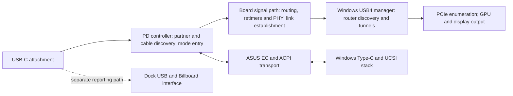

# Investigation goal and working method

**1 November 2026. This is the current investigation plan.** It replaces the earlier automatic progression from finding an EC flag to building a dedicated flag-reader driver. All earlier captures, code and discoveries remain evidence. No new driver, test boot or connection experiment is queued by this plan.

**Current goal:** locate the first failed branch in the ASUS-DEG2 control/message flow, identify its owning component and an observable that distinguishes it, then select one reversible intervention with a predicted outcome.

**Eventual repair goal:** the existing ASUS, DEG2, GPU and cable produce an external USB4 router, a bound GPU and display output through a reversible Windows remedy, followed by reconnect and recovery validation. That result has not been achieved. A new decoder, readable register or successful command is a diagnostic result rather than repair success.

The [current evidence map](investigation-map.md) is the starting point for future work. Its primary view is an architecture/control-flow graph: components, message paths, branch conditions, distinct outcomes and possible intervention locations. The [curated model](../evidence/investigation-model.json) backs that graph with claims, source anchors, separate runs, timelines and counterevidence. Existing research documents remain the detailed references.

## The whole connection, with the visibility limits left visible



This is a responsibility/dependency map. Some operations overlap, and the arrows do not establish which chip programs every switch. The exact ASUS board routing and full PD-controller firmware remain partly unidentified. Billboard is also present in the working Dell evidence, so its presence alone does not identify a failure.

Microsoft describes router detection, configuration and tunnel management as [USB4 connection-manager responsibilities](https://learn.microsoft.com/en-us/windows-hardware/design/component-guidelines/usb4-intro-to-connection-manager). It also states that the Windows USB4 connection manager has no software dependency on the Type-C stack. Therefore a successful UCSI command establishes a control-path observation without certifying USB4 entry or electrical link success. [Microsoft design requirements](https://learn.microsoft.com/en-us/windows-hardware/design/component-guidelines/usb4-design-details-and-general-requirements).

The current blind interval extends from controller discovery/entry through signal-path/link establishment to external-router discovery. We have no fresh Enter_USB/reply/exit history. A usable link followed by failed router enumeration is also still possible. Those explanations may occur in combination.

## Why the approach needs to change

We have accumulated findings at several layers faster than we have connected them to a measured failed transition. That makes a genuine defect, an absent diagnostic feature and an unknown private bit look equally actionable. They are not equally informative.

- The updater target-lifetime defect is real; a working ASUS peer link weakens the claim that it universally blocks USB4.
- The OEM table6 response timeout is explained by a silent getter in the reviewed EC build; it is not a recorded USB-C handshake timeout.
- The blocking flag has a known code effect, but no measured value during attachment. Successful Windows commands oppose a continuously blocked host-command worker.
- Windows role policy differs between hosts, but the completed policy-only intervention did not fix the pairing.

These discoveries are retained with their scope and counterevidence. A lead earns further work through its relationship to the failed transition and the observation it can supply. Undocumented names, strange bit patterns and test counts do not establish that relationship.

Some private firmware meanings may require ASUS or controller-vendor engineering material. The investigation must name that visibility limit instead of guessing meanings or treating unavailable telemetry as a faulty chip. A useful escalation would ask for the responsible PD firmware/version and an entry/link decision log, accompanied by a concise working-versus-failing comparison. No message or support request has been sent.

## The evidence system now in the repository

The current curated view covers **61 claims, 68 exact JSON source values, 22 explicitly separated cases and two software-report timelines**. The control-flow graph tags relationships as measured, traced from code, documented architecture or unmapped. Distinct branches remain distinct: choosing no Windows role command and skipping an EC service invocation are different outcomes. The index covers decision-relevant evidence; it does not claim every file or raw event has been ingested.

Each claim records its evidence class, case, source location and limit. Inferences require a stated reason. Relevant counterevidence is linked to the competing explanations. Source values are pinned by a canonical SHA-256; a missing or changed field fails validation rather than becoming zero or silently retaining an old interpretation. Changes elsewhere in a source file do not invalidate an unrelated pinned field.

The checker also refuses a measured claim supported only by code/emulation, a claim using a superseded source, a missing cross-reference, a silently mixed case and a source path outside the public evidence directory. These checks enforce bookkeeping rules. **They cannot establish that an analyst's label or causal interpretation is correct.** Raw ETL/dump provenance remains in the existing evidence records; hashing a summary field does not revalidate the original capture.

Run from the repository root with ordinary Python; there are no new dependencies:

```text
python tools/analysis/Read-Investigation.py --check
python tools/analysis/Read-Investigation.py --claim C10
python tools/analysis/Read-Investigation.py --stage entry
python tools/analysis/Read-Investigation.py --write-report
```

The reader's last command writes the architecture report in UTF-8 after validation. For the owner's selected offline automation, use `python tools/analysis/Run-Investigation.py`: it also refreshes the [truth table](investigation-truth-table.md) and its machine-readable results. `--check` checks all three outputs without writing. [Operation and limits](offline-investigation.md). The owner subsequently authorized separate recurring offline research intervals with a10% usage reserve; see the [interval checkpoint](ps8830-investigation-intervals.md). The runner itself does not schedule work. The tools have no capture, firmware-access, driver-loading or network backend. They do not automatically repin changed source values. Updating a claim requires reviewing the changed value, its case and any counterevidence, then updating the pin deliberately.

The timelines preserve original timestamps and align T0 to the first recorded software attachment report in each run. They preserve different capture dates and distinguish the earlier Dell control from the later Dell deep dump. They do not align physical insertion or turn asynchronous Windows reporting into wire-level causation.

## The next offline job

The [saved native port reads](offline-investigation.md) already distinguish the next Windows decision: both hosts initially take Plugged No, but Dell's following RouterDetected bit13 is set and ASUS's is clear. Original code agrees with those readbacks. Follow what supplies the ASUS retimer mode configuration and native port-status value, including ownership and timing. The PS8830 reference shows two control paths but does not establish actual ASUS wiring. A software-written USB4 mode flag is not an independent link-ready measurement.

Use the map to qualify **one observation of the missing transition**. Audit the retained connection-manager traces and original routines for a specific status or error that reports entry/exit, physical-link readiness, or the first router/configuration transaction. Reuse the already decoded records and Microsoft [trace/rundown/debugger mechanisms](https://learn.microsoft.com/en-us/windows-hardware/design/component-guidelines/usb4-debugging-and-troubleshooting); decoding the same fields again is not new evidence.

The output of that job is a short acquisition decision containing:

| Required answer | Meaning |
| --- | --- |
| Observation | Exact field/event and component/physical-port ownership; whether it is a fresh event, current value or retained cache. |
| Alternatives separated | Which of entry skipped/refused, unusable link, later exit, or failed router discovery the possible results distinguish. |
| Access | Existing capture/interface first; proven request framing and read/clear/side effects where applicable. |
| Positive control | Existing successful evidence that demonstrates the observer can see the event/value; a new Dell run only if necessary to validate a new channel. |
| Decisions | What each positive, negative, unreadable or ambiguous result changes in the investigation. |
| Cost and recovery | Owner actions, installs, security changes, duration, interference, owned resources and verified undo. |

If an offline pass cannot show what useful value the proposed interface returns, defer that mechanism with the specific missing prerequisite. Do not recursively expand an emulator or build a loader merely because the address is interesting. Switch to another evidence source or document a precise OEM logging requirement.

## Minimise drivers and experiments

**Current acquisition budget: zero new drivers and zero live trials.** Offline source/index work proceeds without asking the owner to reconnect, reboot or approve repeated prompts.

If a helper becomes necessary, propose one narrow, reusable observer covering only justified read locations or documented requests. Several useful observations from one attachment are preferable when the collectors can coexist without altering negotiation. The known flag is a secondary channel candidate, not sufficient justification by itself. Loading, signing and recovery must be concrete before a new experiment is selected; this plan does not authorize a boot/security change.

The default future diagnostic trial is **one bounded ASUS attachment with the needed passive channels already armed**. Reuse existing Dell controls where they validate the same channel. Add a Dell attachment only if the new observer needs a positive control that the existing material cannot supply. A later repeat requires a stated reason such as an invalid capture, missing control or a new distinguishing condition.

Changing policy belongs to a later repair experiment. It needs one specified intervention, a predicted observable result, an applicable failing baseline and exact recovery. Fresh baseline acquisition is justified if the existing baseline no longer represents the experimental conditions. Once the planned observation is obtained, analyse it before selecting another experiment.

## What counts as progress

1. **Observation progress:** a new measured distinction between the still-open explanations, with its physical/logical owner and limits.
2. **Causal progress:** a proposed mechanism predicts a specific failed transition and survives the relevant counterevidence or a controlled intervention.
3. **Repair progress:** the predicted intervention restores router/GPU/output and survives the necessary reconnect and rollback checks.

Keep those results separate. The successful tests for the new evidence reader validate source handling and reporting; they are not new hardware observations. The current phase delivers a reliable way to locate and assess the evidence while preserving the remaining unknowns.
